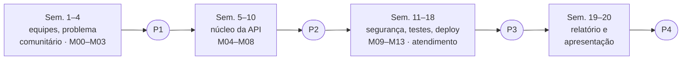

# DPW — Desenvolvimento de Projeto Web

Material didático da disciplina **Desenvolvimento de Projeto Web**, do curso superior de
**Tecnologia em Análise e Desenvolvimento de Sistemas (ADS)** do **Instituto Federal de
Pernambuco (IFPE)**.

> **Em uma frase:** em equipes, a turma constrói e coloca no ar uma **API** pensada para um
> problema de uma **comunidade** — do próprio campus ou da região — e cada módulo ensina uma
> peça desse sistema. Trabalhar com uma organização real é opcional e vale bônus.
>
> **Stack:** Node 24 LTS · TypeScript · NestJS 12 · TypeORM · PostgreSQL 16 · Git/GitHub ·
> Docker · GitHub Actions · deploy em PaaS. Backend-first: não há frontend no escopo. Por quê:
> [`docs/decisoes-tecnicas.md`](docs/decisoes-tecnicas.md).

---

## Como a disciplina funciona



1. **Um projeto, do início ao fim.** Desde a semana 1, o código da turma é o do projeto da
   equipe. Os módulos mostram cada conceito com um exemplo curto e dizem, na seção
   **🧩 No projeto da equipe**, o que fazer no sistema de vocês.
2. **A nota é da equipe.** Ela vem de quatro entregas, e nenhuma depende de uma organização
   de fora. Cada pessoa é acompanhada pelos commits, pela avaliação dos colegas e pela
   arguição oral.
3. **Toda entrega diz por que existe.** As páginas do [projeto](projeto/README.md) começam
   pelo motivo e pelo objetivo de cada uma.

| Entrega | Semana | Peso | Por que existe |
| --- | ---: | ---: | --- |
| [P1 — Definição e planejamento](projeto/etapa-1-definicao-do-tema/) | 4 | 15% | Entender o problema antes de programar |
| [P2 — Sistema preliminar](projeto/etapa-2-sistema-preliminar/) | 10 | 25% | Corrigir o rumo enquanto há tempo |
| [P3 — Sistema final](projeto/etapa-3-desenvolvimento/) | 18 | 40% | Entregar um sistema que alguém poderia usar de verdade |
| [P4 — Relatório e encerramento](projeto/etapa-4-relatorio-e-encerramento/) | 19–20 | 20% | Explicar, medir e deixar pronto para entregar |
| ➕ [Parceria com a comunidade](projeto/extensao/) | opcional | bônus até +1,0 | Levar o sistema a uma organização real |

## Como navegar

| Pasta | O que contém |
| --- | --- |
| [`projeto/`](projeto/) | **Comece aqui.** As entregas, o que cada módulo deixa no projeto, e os modelos de documentos |
| [`modulos/`](modulos/) | 14 módulos (M00–M13), cada um terminando com a aplicação no projeto |
| [`avaliacao/`](avaliacao/) | Composição da nota, rubricas e fator de participação |
| [`docs/`](docs/) | Plano de ensino (com calendário), setup do ambiente, decisões técnicas, glossário e FAQ |
| [`recursos/`](recursos/) | Checklists, código de apoio e guia de comandos do Windows |
| [`slides/`](slides/) | Apresentações em HTML (M03, M04, M06) |

**Por perfil:**

- **Estudante** → [`projeto/README.md`](projeto/README.md) → [monte o ambiente](#montagem-do-ambiente) → [`modulos/00-ambiente-e-ferramentas/`](modulos/00-ambiente-e-ferramentas/)
- **Docente** → [`docs/plano-de-ensino.md`](docs/plano-de-ensino.md) (calendário e preparação do semestre) → [`avaliacao/`](avaliacao/)

## Trilha de módulos

| # | Módulo | Semana | No projeto |
| --- | --- | ---: | --- |
| 00 | [Ambiente e ferramentas](modulos/00-ambiente-e-ferramentas/) | 1 | Repositório da equipe |
| 01 | [Fundamentos da web e HTTP](modulos/01-fundamentos-web-http/) | 2 | Requisições do cenário principal |
| 02 | [Arquitetura desacoplada e contrato de API](modulos/02-arquitetura-desacoplada/) | 3 | Contrato inicial |
| 03 | [NestJS: a primeira API](modulos/03-nestjs-primeiros-passos/) | 4 | `backend/` respondendo |
| 04 | [Entidades: classes que geram o banco](modulos/04-entidades-typeorm/) | 5–6 | Modelo de dados |
| 05 | [Migrações](modulos/05-migracoes/) | 6 | Banco versionado |
| 06 | [Repository e QueryBuilder: consultas e CRUD](modulos/06-orm-consultas-crud/) | 6–7 | CRUD no banco |
| 07 | [API: rotas, controllers e DTOs](modulos/07-api-controllers-dtos/) | 8–9 | Entrada e saída controladas |
| 08 | [Autenticação e autorização](modulos/08-autenticacao-usuarios/) | 9–10 | Login e papéis |
| 09 | [Segurança de APIs](modulos/09-seguranca/) | 11 | Correções de segurança |
| 10 | [Testes e qualidade](modulos/10-testes-e-qualidade/) | 12 | Testes no CI |
| 11 | [Contrato OpenAPI versionado](modulos/11-tipos-compartilhados/) | 13 | Contrato verificado |
| 12 | [Deploy da API](modulos/12-deploy/) | 13–14 | API no ar |
| 13 | [Observabilidade e manutenção](modulos/13-observabilidade-e-manutencao/) | 14 | Backup testado e plano |

---

## Convenções do material

- **Por que este módulo existe no projeto** — o problema antes da solução.
- 📖 **Conceitos** — o essencial, com exemplo curto.
- 🧩 **No projeto da equipe** — o que fazer no sistema de vocês, com **Deu certo se** para conferir.
- ⚠️ **Erros comuns** — o que quebra na prática e como diagnosticar.
- ✅ **Marco do módulo** — o que precisa estar no repositório ao final.
- 🤖 **IA no fluxo** — onde um assistente ajuda, e o que continua sendo decisão da equipe.

### Blocos de comando

Comando que difere entre plataformas aparece em pares: ` ```bash ` (Linux, macOS, WSL, Git
Bash) e ` ```powershell ` (Windows, como nos laboratórios do campus). Blocos iguais nas três
plataformas (`git`, `npm`, `npx`) aparecem uma vez só. No PowerShell, `curl` é `curl.exe`.

## Montagem do ambiente

O ambiente é montado **pela turma, comando a comando** — faz parte do conteúdo. Nada é
instalado antes da hora:

| Momento | O que entra | Conferir com |
| --- | --- | --- |
| **Início** (M00) | Node 24, Git, VS Code, repositório da equipe | `node recursos/codigo/verifica-ambiente.mjs` |
| **Antes do M03** | NestJS CLI e as dependências do backend | `--etapa m03` |
| **Antes do M04** | Docker + PostgreSQL | `--etapa m04` |

Guia único para Windows, Linux e macOS: [`docs/ambiente-setup.md`](docs/ambiente-setup.md).
🪟 Armadilhas do Windows que não se resolvem trocando o comando (`curl`, `&&`, `>` em UTF-16,
variáveis inline): [`recursos/comandos-windows.md`](recursos/comandos-windows.md).

## Licença

Conteúdo sob [CC0 1.0](LICENSE) — uso livre, inclusive comercial e sem atribuição.
