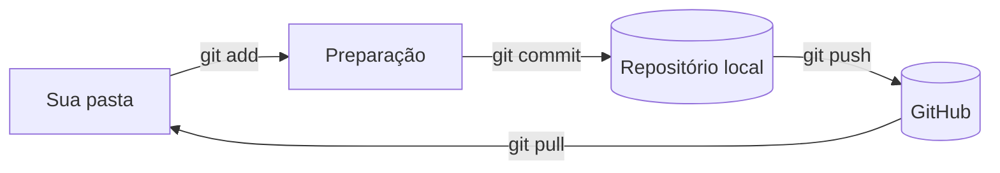

# M00 — Ambiente e ferramentas

> **Pré-requisito:** nenhum · **Duração:** média · **Semana:** 1
> **No projeto:** cria o repositório da equipe · conferido na P2 (critério 4) e na P3 (critério 6)

## Por que este módulo existe no projeto

Quatro pessoas vão escrever o mesmo sistema durante 18 semanas. Sem um ambiente igual para
todos e um jeito combinado de juntar o código, metade do tempo vai para "na minha máquina
funciona" e para conflitos de merge. Este módulo monta a base: **o repositório da equipe**,
com as regras que valem até o fim do semestre.

## 🎯 Ao final do módulo

1. A equipe tem **um repositório** no GitHub, com `main` protegida.
2. Cada integrante clonou, instalou e rodou o projeto na própria máquina.
3. Cada integrante abriu **um Pull Request** que outra pessoa revisou e mesclou.

---

## 📖 Conceitos

### 1. Dependências ficam dentro do projeto

O projeto A precisa do NestJS 11; o B, do NestJS 12. Se a instalação fosse uma só para a
máquina inteira, um sobrescreveria o outro. Por isso **cada projeto Node tem sua própria
pasta `node_modules/`**, e não há nada para "ativar": basta estar dentro da pasta.

**No projeto:** todo mundo instala as dependências com `npm install` na raiz do repositório.

### 2. Reprodutibilidade: o projeto precisa rodar em qualquer máquina

| Arquivo | Função | Vai para o Git? |
| --- | --- | --- |
| `package.json` | Quais dependências, e em que faixa de versão | Sim |
| **`package-lock.json`** | A versão **exata** de cada uma | **Sim** |
| `node_modules/` | As dependências baixadas — reconstruível com `npm install` | **Não** |
| `.env` | Configuração com segredos (senha do banco) | **Não** |
| `.env.example` | Quais variáveis existem, sem os valores | Sim |
| `README.md` | Como subir o projeto em poucos comandos | Sim |

O `package.json` diz `"^12.0.0"`, que aceita 12.0.0 ou 12.4.2; o **lock** registra qual
delas foi. É ele que garante que os quatro integrantes, o CI e o servidor rodem a mesma
coisa. **Nunca apague o lock para "resolver" um erro**: o erro some na sua máquina e aparece
na do colega.

**No projeto:** a P3 exige um README que suba o backend em poucos comandos. Ele começa hoje.

### 3. Git: fotos do projeto, com legenda

Cada **commit** é uma foto do projeto inteiro, com uma frase dizendo o que mudou. Uma
**branch** é um caminho paralelo, onde você trabalha sem mexer na `main`. Um **Pull Request
(PR)** é o pedido para juntar sua branch à `main`, com revisão de outra pessoa.



O fluxo da equipe, do M00 até a P3:

```text
história do backlog → branch → commits pequenos → PR → revisão → merge na main
```

**No projeto:** a `main` é protegida — ninguém faz push direto nela. Todo código entra por
PR revisado. É isso que a P3 confere no critério 6, e o histórico de commits de cada pessoa
entra no [fator de participação](../../avaliacao/README.md#3-nota-da-equipe-e-participação-de-cada-pessoa).

### 4. Mensagens de commit

```text
<tipo>(<escopo>): <o que mudou, no imperativo>

feat(cadastro): adiciona busca por nome
fix(agenda): impede reserva em horário ocupado
docs: atualiza instruções de instalação
```

Tipos: `feat`, `fix`, `docs`, `refactor`, `test`, `chore`. A mensagem diz **por quê**; o
diff já mostra o quê. Nada de "ajustes" ou "final v2 agora vai".

---

## 🧩 No projeto da equipe

### Passo 1 — Cada pessoa instala as ferramentas

Só três coisas hoje: **Node 24 (LTS), Git e VS Code**. Docker entra no M04, quando passa a
servir para alguma coisa. Siga o [guia de ambiente](../../docs/ambiente-setup.md), passos
0 a 6 — ele traz o comando de Windows 🪟 e de Linux/macOS 🐧 lado a lado.

> 🪟 **No Windows, não "adapte" comandos de Linux.** Use o bloco 🪟 do guia.

**Deu certo se:** os quatro comandos respondem uma versão.

```bash
node --version      # v24 ou superior
npm --version
git --version
code --version
```

### Passo 2 — Uma pessoa cria o repositório

Escolham um nome curto para o projeto, sem espaço nem acento. Nos exemplos do material, ele
se chama `projeto`. A pessoa que fará o papel de *Ops* na primeira sprint cria a pasta:

```bash
# Linux / macOS / WSL / Git Bash
mkdir -p ~/dev/projeto && cd ~/dev/projeto
```

```powershell
# Windows PowerShell — fora do OneDrive, sem espaço nem acento no caminho
New-Item -ItemType Directory -Force -Path C:\dev\projeto
Set-Location C:\dev\projeto
```

Crie o manifesto com `npm init -y` e **edite** o `package.json` para:

```json
{
  "name": "projeto",
  "private": true,
  "workspaces": ["backend", "pacotes/*"],
  "scripts": {
    "dev:api": "npm run -w backend start:dev"
  }
}
```

| Campo | Para quê |
| --- | --- |
| `"private": true` | Impede publicar o projeto no npm por acidente |
| `"workspaces"` | Um repositório com várias partes: `backend/` nasce no M03 e `pacotes/tipos/` no M11. Um único `npm install` na raiz instala todas |
| `scripts` | `npm run dev:api` sobe o backend a partir da raiz |

Rode `npm install`. **Deu certo se** surgirem `node_modules/` e `package-lock.json`.

### Passo 3 — Decidir o que não entra no Git

Ainda na raiz, crie três arquivos **pelo VS Code** (`code .gitignore`). 🪟 O Bloco de Notas
grava `.gitignore.txt` e esconde a extensão.

**`.gitignore`** — o que fica de fora:

```gitignore
node_modules/
dist/
coverage/
*.log
.env
.env.*
!.env.example
.vscode/
.idea/
.DS_Store
Thumbs.db
```

> **Segredo que entra no Git é segredo vazado** — mesmo apagado depois, continua no
> histórico. Por isso o `.env` fica de fora desde o primeiro commit.

**`.gitattributes`** — finais de linha iguais para todos (sem isto, o deploy do M12 falha
com `bad interpreter` quando alguém usa Windows):

```gitattributes
* text=auto eol=lf
*.bat text eol=crlf
*.ps1 text eol=crlf
*.png binary
*.jpg binary
```

**`README.md`** — o que alguém precisa para rodar o projeto. Ele cresce a cada módulo:

````markdown
# <Nome do projeto>

<Uma frase: para qual organização, resolvendo qual problema.>

## Equipe

## Como rodar

```bash
npm install
npm run dev:api      # http://localhost:3000/api/docs (a partir do M03)
```
````

### Passo 4 — Primeiro commit e publicação

```bash
git init
git config core.autocrlf input
git status
git add .
git commit -m "chore: inicializa estrutura do projeto"
```

**Leia o `git status` antes de commitar.** Deu certo se aparecerem só `.gitignore`,
`.gitattributes`, `README.md`, `package.json` e `package-lock.json`. Se `node_modules/` ou
`.env` aparecerem, pare e corrija o `.gitignore`.

Crie o repositório **vazio** na organização GitHub da turma (sem README nem `.gitignore`) e
publique:

```bash
git remote add origin git@github.com:<organizacao-da-turma>/projeto.git
git branch -M main
git push -u origin main
```

Em *Settings → Collaborators*, adicione o resto da equipe e o docente.

### Passo 5 — Proteger a `main`

Em *Settings → Branches → Add rule* para `main`: exija Pull Request antes do merge e
**1 aprovação**. No M10 vocês acrescentam "CI verde".

### Passo 6 — Cada integrante faz o seu primeiro PR

Cada pessoa clona, instala e acrescenta **o próprio nome** na seção "Equipe" do README:

```bash
git clone git@github.com:<organizacao-da-turma>/projeto.git
cd projeto
npm install
git switch -c docs/equipe-<seu-nome>
# edite o README.md
git add README.md
git commit -m "docs: adiciona <seu nome> à equipe"
git push -u origin docs/equipe-<seu-nome>
```

No GitHub: **Compare & pull request** → descreva → peça revisão a um colega → o revisor
comenta ao menos uma sugestão → aplique → *Merge*. Depois:

```bash
git switch main
git pull
git branch -d docs/equipe-<seu-nome>
```

Os PRs vão conflitar no README — **isso é proposital**. Resolver o primeiro conflito em aula,
com ajuda, é muito melhor que resolver o primeiro na véspera da P2.

### Passo 7 — Conferir o ambiente

```bash
node <caminho-deste-material>/recursos/codigo/verifica-ambiente.mjs
```

O script **não instala nada**: confere e, para cada falha, diz o comando que corrige. Os
itens do M03 e do M04 aparecem como pendentes até lá.

---

## ⚠️ Erros comuns

| Sintoma | Diagnóstico |
| --- | --- |
| `Cannot find module` depois de clonar | Faltou `npm install` na raiz |
| `node_modules/` ou `.env` no `git status` | Falta a linha no `.gitignore` |
| Colega tem versão diferente da sua | O `package-lock.json` não foi commitado, ou alguém o apagou |
| Push rejeitado na `main` | A `main` está protegida (como deve): abra um PR |
| Push rejeitado na sua branch | Alguém enviou antes: `git pull --rebase` |
| Cinco commits `wip` seguidos | Commit é uma mudança coerente, não botão de salvar |

🪟 Erros de Windows (política de execução, OneDrive, `Filename too long`) estão em
[`docs/ambiente-setup.md`, passo 10](../../docs/ambiente-setup.md#passo-10--erros-e-diagnóstico).

## 🤖 IA no fluxo

Assistentes explicam bem mensagens de erro de instalação e de Git: cole a mensagem inteira.
Desconfie de comandos com `sudo`, `--force` ou `Set-ExecutionPolicy Unrestricted`, que
resolvem o sintoma abrindo uma porta maior.

## ✅ Marco do módulo

- [ ] Repositório da equipe na organização da turma, com `.gitignore`, `.gitattributes` e `README.md`
- [ ] `main` protegida: PR obrigatório e 1 aprovação
- [ ] **Cada integrante** clonou, rodou `npm install` e teve um PR revisado e mesclado
- [ ] `package-lock.json` versionado; `node_modules/` e `.env` fora
- [ ] `verifica-ambiente.mjs` com os itens do M00 em OK em todas as máquinas

## 📚 Para aprofundar

- [Pro Git (em português)](https://git-scm.com/book/pt-br/v2)
- [Learn Git Branching](https://learngitbranching.js.org/?locale=pt_BR)
- [Conventional Commits](https://www.conventionalcommits.org/pt-br/)
- [npm — workspaces](https://docs.npmjs.com/cli/using-npm/workspaces)
- 🪟 [`recursos/comandos-windows.md`](../../recursos/comandos-windows.md)
