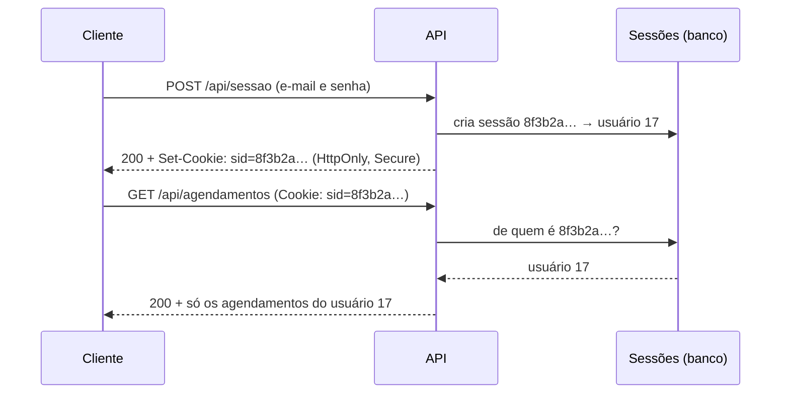

# M01 — Fundamentos da web e protocolo HTTP

> **Pré-requisito:** M00 · **Duração:** longa · **Semana:** 2
> **Ementa:** *Introdução a aplicações web: Como funcionam; Protocolo HTTP: métodos POST e GET.*
> **No projeto:** dá a linguagem do contrato da API · usado na P1 (critério 5)

## Por que este módulo existe no projeto

O sistema que a equipe vai construir é uma **API**: um programa que recebe mensagens HTTP e
responde mensagens HTTP. A organização, um aplicativo ou outro sistema só conversam com ele
por aí. Toda decisão dos próximos módulos — que rota criar, que status devolver, onde validar,
como saber quem está logado — é uma resposta a alguma regra do HTTP.

Nesta semana a equipe também **pesquisa o problema** que escolheu (P1). Ao fim do módulo,
vocês conseguem olhar para o cenário principal das personas e dizer quais requisições ele
vai gerar.

## 🎯 Ao final do módulo

1. Descrever o caminho de uma requisição, da URL à resposta.
2. Ler uma mensagem HTTP crua: linha inicial, cabeçalhos e corpo.
3. Escolher o método pela semântica (seguro, idempotente), não pelo "aparece na URL".
4. Escolher o status certo e diagnosticar com `curl` e DevTools.
5. Explicar como o servidor "lembra" de alguém, se o HTTP não tem memória.

---

## 📖 Conceitos

### 1. O caminho de uma requisição

```text
https://api.exemplo.org.br/agendamentos/42?formato=resumo
└─┬──┘ └───────┬─────────┘└──────┬──────┘ └─────┬──────┘
esquema       host            caminho       query string
```

1. **DNS** descobre o IP do host.
2. **TCP + TLS** abrem uma conexão criptografada (porta 443).
3. O cliente envia a **requisição** (texto).
4. O servidor encaminha para o código responsável (o *controller*, no M03), que consulta o
   banco e monta a **resposta** — JSON, no caso de uma API.
5. **O servidor esquece tudo.** A próxima requisição começa do zero.

HTTP funciona como troca de **cartas**: cada carta tem endereço e instruções na frente (os
cabeçalhos) e conteúdo dentro (o corpo). O destinatário não guarda cópia: cada carta precisa
se explicar sozinha.

> **Validação no cliente é conveniência; validação no servidor é segurança.** Tudo que chega
> pode ter sido forjado com um `curl`. **No projeto:** toda regra da organização é conferida
> na API (M07), nunca só na tela de quem a usa.

### 2. Anatomia de uma mensagem

```http
POST /api/agendamentos HTTP/1.1
Host: api.exemplo.org.br
Content-Type: application/json
Cookie: sid=8f3b2a...

{"pessoaId": 7, "data": "2026-09-14T10:00"}
```

`MÉTODO CAMINHO VERSÃO` → cabeçalhos → **linha em branco** → corpo.

```http
HTTP/1.1 201 Created
Content-Type: application/json; charset=utf-8
Location: /api/agendamentos/42

{"id": 42, "pessoaId": 7, "data": "2026-09-14T10:00:00.000Z"}
```

`VERSÃO STATUS RAZÃO` → cabeçalhos → linha em branco → corpo.

| Cabeçalho | Para quê | Onde aparece no curso |
| --- | --- | --- |
| `Content-Type` | Formato do corpo | Toda resposta da API |
| `Cookie` / `Set-Cookie` | Estado entre requisições | Login (M08) |
| `Authorization` | Credencial | Alternativa ao cookie (M08) |
| `Location` | Onde está o recurso criado | Respostas 201 (M07) |
| `Access-Control-*` | Quem pode chamar a API pelo navegador | CORS (M09) |

### 3. Métodos: a pergunta é "o que acontece se repetir?"

Duas propriedades definem tudo:

- **Seguro** — não altera nada no servidor.
- **Idempotente** — repetir N vezes tem o mesmo efeito de fazer uma.

| Método | Seguro | Idempotente | Corpo | Uso na API |
| --- | :---: | :---: | :---: | --- |
| `GET` | ✅ | ✅ | não | Ler (listar, buscar, detalhar) |
| `POST` | ❌ | ❌ | sim | Criar |
| `PUT` | ❌ | ✅ | sim | Substituir inteiro |
| `PATCH` | ❌ | ❌ | sim | Alterar parte |
| `DELETE` | ❌ | ✅ | não | Remover |

**GET** pode ser repetido por qualquer um — navegador, cache, robô de busca. Por isso
**nunca altera dados**: uma aplicação que usou `GET /excluir?id=42` num link teve o banco
apagado pelo robô que seguiu todos os links. Os parâmetros vão na URL, então aparecem em
logs e histórico: ótimo para filtro e paginação, péssimo para senha.

**POST** não é idempotente: enviar duas vezes cria dois registros. Clique duplo ou nova
tentativa após falha de rede causam duplicata. **No projeto:** a API recusa a duplicata com
uma regra de negócio e o status `409` (M07).

> POST **não** é "mais seguro" porque esconde os dados da URL. Sem HTTPS, o corpo trafega em
> texto puro. Só o HTTPS protege (M12).

### 4. Códigos de status

| Faixa | Quem errou | Os que a API vai usar |
| --- | --- | --- |
| **2xx** | ninguém | `200 OK`, `201 Created`, `204 No Content` |
| **4xx** | o **cliente** | `400` inválido, `401` não autenticado, `403` sem permissão, `404` não existe, `409` conflito, `429` excesso de tentativas |
| **5xx** | **você** | `500` exceção não tratada, `502` a API caiu atrás do proxy |

- **401 × 403:** 401 é *não sei quem você é*; 403 é *sei, e você não pode*.
- **404 em recurso de outra pessoa:** devolver 404 em vez de 403 esconde que o recurso existe
  (M09).
- **Nunca `200` com `{"erro": ...}`.** Caches, monitores e bibliotecas decidem pelo status.

**No projeto:** o contrato inicial (M02) lista, para cada rota, o status de sucesso e os
erros possíveis. É daqui que vem esse vocabulário.

### 5. HTTP não tem memória: cookies e sessões

Como a API sabe quem está logado, se cada requisição começa do zero? Como o **número de
protocolo** de um atendimento por telefone: a atendente não lembra de você, mas encontra a
conversa anterior pelo número.



| Atributo do cookie | Efeito |
| --- | --- |
| `HttpOnly` | JavaScript não lê o cookie (protege contra roubo por XSS) |
| `Secure` | Só trafega em HTTPS |
| `SameSite=Lax` | Não vai em requisições disparadas por outros sites (protege contra CSRF) |

**No projeto:** é exatamente isto que vocês implementam no M08.

---

## 🛠️ Prática em aula

### Prática 1 — Falar HTTP com `curl`

> 🪟 **No PowerShell, escreva `curl.exe`**, não `curl` (que é apelido de outro programa), e use
> a crase (`` ` ``) para quebrar linha. No Git Bash e no WSL, cole como está.

```bash
curl -I https://nodejs.org/                       # só os cabeçalhos
curl -v https://httpbin.org/get                   # o que foi enviado e recebido
curl "https://httpbin.org/get?q=nest&pagina=2"    # GET com query string
curl -X POST https://httpbin.org/post \
     -H "Content-Type: application/json" \
     -d '{"nome": "Ana", "vagas": 3}'             # POST com JSON
curl -c c.txt https://httpbin.org/cookies/set/sid/abc123
curl -b c.txt https://httpbin.org/cookies         # o cookie voltando
```

Para cada um: **qual método, qual status, onde foram os dados** (URL ou corpo) e qual
`Content-Type`.

### Prática 2 — Um servidor sem framework

[`recursos/codigo/servidor-minimo.mjs`](../../recursos/codigo/servidor-minimo.mjs) faz, em
~80 linhas, o que o NestJS faz por vocês. Copie para uma pasta qualquer e rode:

```bash
node servidor-minimo.mjs
```

```bash
# Linux / macOS / WSL / Git Bash
curl -i http://localhost:8000/itens
curl -i http://localhost:8000/nao-existe
curl -i -X POST http://localhost:8000/eco -d '{"nome":"teste"}'
curl -i -X POST http://localhost:8000/eco -d 'isto não é json'
```

```powershell
# Windows PowerShell
curl.exe -i http://localhost:8000/itens
curl.exe -i http://localhost:8000/nao-existe
curl.exe -i -X POST http://localhost:8000/eco -d '{\"nome\":\"teste\"}'
curl.exe -i -X POST http://localhost:8000/eco -d 'isto não é json'
```

Abra o arquivo e encontre cada responsabilidade que o framework vai assumir:

| No servidor mínimo | No NestJS (onde aparece) |
| --- | --- |
| `new URL(req.url)` + a tabela `rotas` | Roteamento: `@Get(':id')` (M03) |
| `req.on("data")` juntando pedaços | Leitura do corpo: `@Body()` (M07) |
| `JSON.parse` dentro de `try` | Validação: `ValidationPipe` (M07) |
| `responder(res, 404, …)` à mão | `NotFoundException` (M03) |
| `X-Content-Type-Options` digitado | `helmet` (M09) |

Repare no que **não** existe: nada valida os campos, nada impede uma rota de derrubar o
processo. Cada ausência é uma linha que vocês escreveriam sem framework.

---

## 🧩 No projeto da equipe

Com a pesquisa do problema em mãos, peguem o **cenário principal** das personas e, juntos,
escrevam em `docs/cenario-http.md`:

1. Cada passo do cenário, e a **requisição** que ele gera (método + caminho).
2. Para cada uma: é segura? É idempotente? O que acontece se o usuário enviar duas vezes?
3. O status de sucesso e pelo menos um status de erro (com o motivo, em linguagem de quem
   usa: *"a ferramenta já está emprestada"* → `409`).

Exemplo, num cenário de agendamento:

| Passo do cenário | Requisição | Sucesso | Erro possível |
| --- | --- | --- | --- |
| Ver horários livres do dia | `GET /api/horarios?data=2026-09-14` | 200 | 400 data inválida |
| Marcar um horário | `POST /api/agendamentos` | 201 | 409 horário já ocupado |
| Cancelar | `DELETE /api/agendamentos/42` | 204 | 404 não existe |

Este rascunho é o ponto de partida do contrato da API no M02 e entra no critério 5 da P1.

## ⚠️ Erros comuns

| Erro | Por que é errado |
| --- | --- |
| GET que altera ou exclui | Robôs, cache e pré-carregamento disparam a ação |
| "POST é seguro porque não mostra os dados" | Sem HTTPS, o corpo trafega em texto puro |
| Confiar na validação da tela | Qualquer um chama a API com `curl` |
| `200` com erro no corpo | Clientes e monitores leem o status |
| Senha ou token na query string | Vai para logs, histórico e `Referer` |

## 🤖 IA no fluxo

Cole uma resposta HTTP inteira num assistente e peça para explicar cada cabeçalho. O que ele
não faz é **observar**: o `curl -i` mostra o que está acontecendo de fato. Quando os dois
discordarem, a resposta real tem razão.

## ✅ Marco do módulo

- [ ] Cada integrante rodou as duas práticas e sabe explicar o que viu
- [ ] `docs/cenario-http.md` no repositório, via PR: requisições do cenário principal, com método e status
- [ ] A equipe sabe justificar cada método por "seguro" e "idempotente"

## 📚 Para aprofundar

- [MDN — Visão geral do HTTP](https://developer.mozilla.org/pt-BR/docs/Web/HTTP/Overview)
- [MDN — Métodos](https://developer.mozilla.org/pt-BR/docs/Web/HTTP/Methods) · [Status](https://developer.mozilla.org/pt-BR/docs/Web/HTTP/Status)
- [RFC 9110 — HTTP Semantics](https://www.rfc-editor.org/rfc/rfc9110.html)
- [httpbin.org](https://httpbin.org) — serviço de eco para testar requisições
