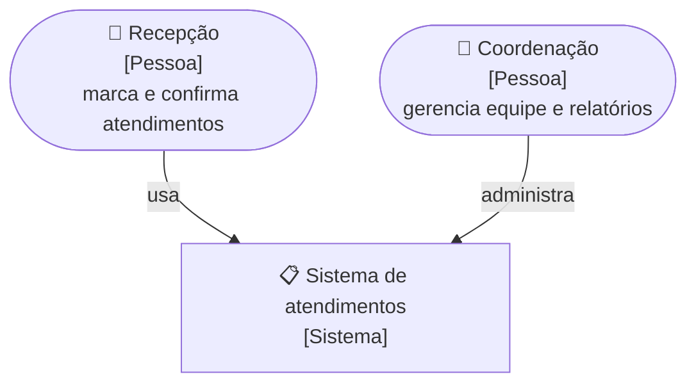
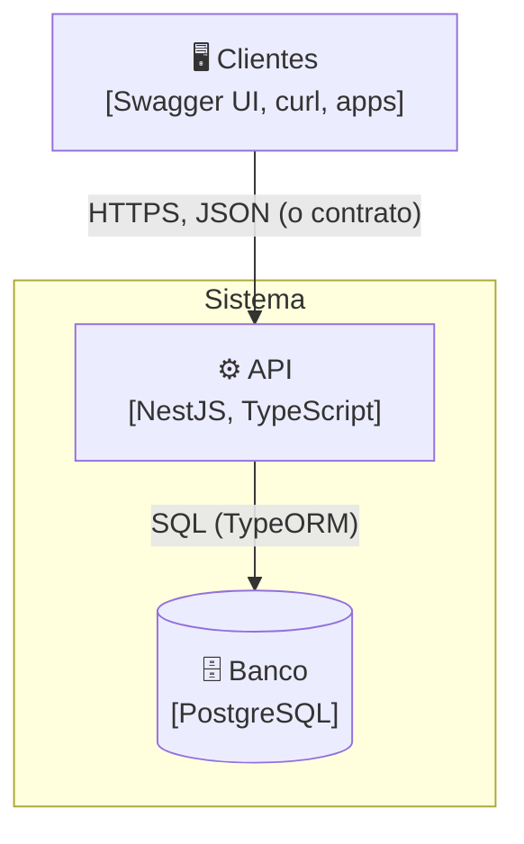
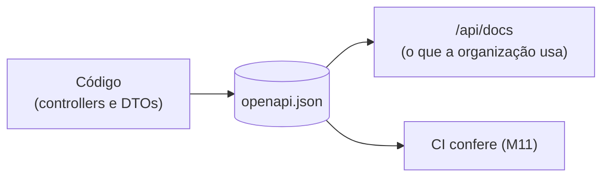

# M02 — Arquitetura desacoplada e contrato de API

> **Pré-requisito:** M01 · **Duração:** curta · **Semana:** 3
> **Ementa:** *Introdução a aplicações web: como funcionam.*
> **No projeto:** produz o contrato inicial da API (`docs/api.md`) · P1 (critério 5) e P4 (critério 1)

## Por que este módulo existe no projeto

Antes de escrever a primeira rota, a equipe precisa combinar **o que a API vai oferecer**:
quais recursos, em quais URLs, com quais respostas e quais erros. Esse acordo é o
**contrato**. Ele vem antes do código porque é muito mais barato mudar uma tabela num
documento do que mudar uma API que alguém já está usando.

No projeto de vocês, o contrato tem um papel a mais: **a organização vai usar a API pelo
`/api/docs`** (não há frontend no escopo). O contrato é, na prática, a interface com o
usuário. Se ele for confuso, o sistema é confuso.

## 🎯 Ao final do módulo

1. Explicar a diferença entre o servidor montar a tela (MPA) e entregar dados (API).
2. Desenhar o sistema da equipe nos níveis 1 e 2 do **C4 Model**, em Mermaid.
3. Escrever o **contrato inicial da API** do projeto, com recursos, rotas, status e erros.

---

## 📖 Conceitos

### 1. Duas formas de montar uma aplicação web

| | Servidor monta a tela (MPA) | API + clientes |
| --- | --- | --- |
| O servidor devolve | HTML pronto | **Dados** (JSON) |
| Quem decide a apresentação | O servidor | Quem consome (navegador, app, outro sistema) |
| Serve app e integrações | Não, precisa de API à parte | Sim, a mesma API |
| Complexidade | Menor | Maior: o contrato precisa ser explícito |

Pense num **restaurante com entrega**: a cozinha não sabe se o pedido veio do salão, do
telefone ou de um aplicativo. O que todos compartilham é o **cardápio**. A API é o cardápio;
a cozinha (regras e dados) pode mudar por dentro, desde que o cardápio continue valendo.

**No projeto:** a disciplina constrói a cozinha — uma API completa, segura e no ar. Por isso
o cardápio precisa ser impecável: quem usar a API vai conhecê-la só por ele. A decisão está
registrada no [ADR-02](../../docs/decisoes-tecnicas.md#adr-02--o-item-templates-da-ementa).

### 2. O que desacoplar custa

Separar não elimina trabalho, **desloca**:

1. **Validar na tela não é validar.** O `curl` do M01 pula qualquer interface. A validação
   que conta é a da API (M07).
2. **Toda resposta pode ser erro**, e o erro precisa de um formato previsível — por isso o
   formato de erro é parte do contrato.
3. **O contrato pode quebrar em silêncio.** A API renomeia `nome` para `nomeCompleto`,
   continua respondendo `200`, e quem consome passa a mostrar `undefined`. As defesas vêm
   no M07 (DTOs), M10 (testes) e M11 (contrato verificado no CI).

### 3. Desenhar o sistema: o C4 Model

Um **mapa com zoom**: cada nível responde a uma pergunta, e não se misturam níveis no mesmo
desenho.

| Nível | Pergunta | Para quem |
| --- | --- | --- |
| **1. Contexto** | Quem usa o sistema e com que outros sistemas ele conversa? | Qualquer pessoa, inclusive a organização |
| **2. Contêineres** | Quais peças executáveis existem (API, banco)? | A equipe |
| 3. Componentes | Quais módulos existem dentro da API? | Aparece no M03 |

Exemplo de nível 1, para um sistema de agendamento de atendimentos:



Nível 2 — igual para todos os projetos da disciplina:



> **Por que Mermaid?** O diagrama é texto no Markdown: o GitHub desenha, o Git versiona, e
> uma mudança de arquitetura aparece no PR como qualquer código.

### 4. O contrato: recursos, não ações

A URL nomeia **coisas** (substantivos); o método diz o que se faz (verbos). É o M01
aplicado.

| ❌ Verbo na URL | ✅ Recurso + método |
| --- | --- |
| `GET /criarPessoa` | `POST /api/pessoas` |
| `POST /atualizarPessoa?id=7` | `PATCH /api/pessoas/7` |
| `GET /deletarPessoa/7` | `DELETE /api/pessoas/7` |
| `GET /atendimentosDaPessoa/7` | `GET /api/atendimentos?pessoaId=7` |
| `POST /login` | `POST /api/sessao` — o recurso é a sessão |
| `POST /concluirAtendimento/15` | `POST /api/atendimentos/15/conclusao` ✅ |

A última linha é a exceção legítima: quando a operação não é um CRUD simples, uma sub-rota
com substantivo ("a conclusão do atendimento 15") é mais clara que forçar um `PATCH`.

### 5. Formatos que o contrato fixa

**Lista paginada** (implementada no M06):

```json
{ "itens": [ { "id": 7, "nome": "Ana Souza" } ], "total": 128, "pagina": 2, "tamanho": 20 }
```

**Erro** (o formato padrão do NestJS, que vocês vão manter):

```json
{ "message": "Pessoa 999 não encontrada", "error": "Not Found", "statusCode": 404 }
```

Na validação, `message` vira uma lista com todas as falhas. **A forma é sempre a mesma** —
se cada rota errar de um jeito, quem consome precisa de um tratamento por rota.

Decisões a fixar uma vez, para o projeto inteiro:

- [ ] Prefixo: `/api/`
- [ ] Nomes de campo em `camelCase`
- [ ] Datas **sempre** em ISO 8601 (`2026-09-14T10:00:00-03:00`)
- [ ] Dinheiro como string decimal (`"12.50"`), nunca `float`
- [ ] Paginação: `?pagina=` e `?tamanho=`, com teto
- [ ] Relações: **id na escrita** (`"pessoaId": 7`), **resumo na leitura** (`"pessoa": {"id": 7, "nome": "Ana"}`)

### 6. Documentação gerada do código

O contrato só se mantém verdadeiro se não puder divergir do código. A partir do M03, o
`/api/docs` (Swagger) é **gerado** dos controllers e DTOs; no M11, o arquivo `openapi.json`
vai para o Git e o CI acusa qualquer mudança não intencional.



O `docs/api.md` de hoje é o **rascunho**; o `/api/docs` gerado é a versão viva. No M07, a
equipe confronta os dois.

---

## 🧩 No projeto da equipe

Partindo do `docs/cenario-http.md` (M01) e das entidades que vocês identificaram na pesquisa
do problema, escrevam **`docs/api.md`**:

1. **C4 nível 1** com os tipos de usuário das personas, e **nível 2** (o de cima,
   com o nome do sistema de vocês).
2. **Tabela de rotas**, um bloco por recurso:

   | Recurso | Método | Rota | O que faz | Quem pode | Sucesso | Erros |
   | --- | --- | --- | --- | --- | --- | --- |
   | Pessoas | GET | `/api/pessoas` | Lista, com busca | recepção | 200 | — |
   | | POST | `/api/pessoas` | Cadastra | recepção | 201 | 400, 409 CPF repetido |
   | Sessão | POST | `/api/sessao` | Entra | todos | 200 | 401 |
   | Saúde | GET | `/api/health` | A API e o banco respondem? | todos | 200 | 503 |

3. **Um exemplo de JSON** de listagem e de detalhe do recurso principal.
4. **As decisões** da seção 5, marcadas.

A coluna **"Quem pode"** vira autorização no M08–M09; a coluna **"Erros"** vira exceções no
M07. Esta é a peça "contrato inicial" do critério 5 da P1.

## ⚠️ Erros comuns

| Erro | Por que é problema |
| --- | --- |
| Uma rota por tabela do banco | Expõe a estrutura interna; mudar o banco quebra os clientes |
| Verbo na URL | Ignora a semântica do HTTP |
| Contrato só na cabeça de alguém | API e quem consome divergem sem ninguém perceber |
| Data como `"14/09/2026"` | Ambíguo; use ISO 8601 |
| Diagrama misturando níveis do C4 | Pessoa, tabela e classe no mesmo desenho: ninguém entende |

## 🤖 IA no fluxo

Peça a um assistente para **criticar** o `docs/api.md` ("encontre verbos na URL, formatos
inconsistentes e decisões que faltam"). Ele também escreve Mermaid bem. O que ele não sabe é
o que as pessoas do problema precisam — isso vem da pesquisa e das personas da equipe.

## ✅ Marco do módulo

- [ ] `docs/api.md` no repositório, via PR revisado, com C4 níveis 1 e 2
- [ ] Rotas de todos os recursos do MVP, com quem pode, status de sucesso e erros
- [ ] Decisões de formato fixadas (prefixo, datas, paginação, relações)
- [ ] Cada integrante sabe explicar por que a URL é um substantivo

## 📚 Para aprofundar

- [C4 Model](https://c4model.com/)
- [Mermaid](https://mermaid.js.org/intro/)
- [Microsoft — Boas práticas de design de API](https://learn.microsoft.com/pt-br/azure/architecture/best-practices/api-design)
- [OpenAPI Specification](https://spec.openapis.org/oas/latest.html)
