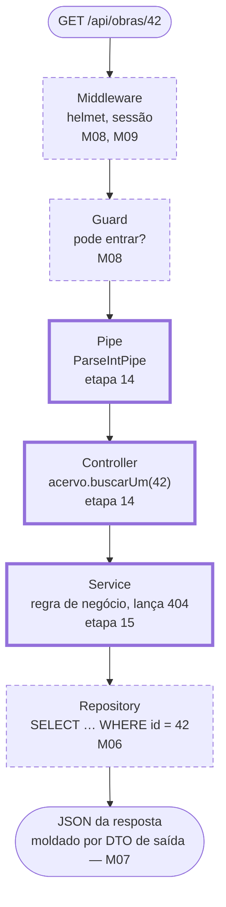

# M03 — NestJS: a primeira API, passo a passo

> **Pré-requisitos:** M01, M02 · **Duração:** média

Primeiro código do backend e primeiro TypeScript da disciplina. Ao final existe uma API que
responde de verdade, e você entende cada linha dela.

> A teoria vem quando o código pede: as etapas 5, 6, 7, 11 e 20 são de leitura e raciocínio.

## 📌 O que a avaliação cobra

| Onde | O quê |
| --- | --- |
| [Portfólio](../../avaliacao/rubrica-portfolio.md) | nenhuma entrega neste módulo |
| [Projeto](../../avaliacao/) | Etapas 2 e 3 — a estrutura da API: regra no *service* (B5) e `/api/docs` (B6). |
| Etapas ➕ opcionais | nenhuma: todas sustentam algo que é avaliado |

## 🎯 Objetivos

Ao final você será capaz de:

1. Ler um projeto NestJS e dizer o que cada arquivo faz.
2. Explicar o que é um **decorator** e por que o framework depende deles.
3. **Justificar** a separação em module, controller e service — não só descrevê-la.
4. Explicar o que **injeção de dependência** resolve, tendo visto o problema antes da solução.
5. Criar endpoints que respondem JSON, com rota, parâmetro e status HTTP corretos.
6. Ler configuração de fora do código e **impedir a aplicação de subir** quando faltar.
7. Publicar a documentação interativa da API com Swagger em `/api/docs` e gerar o schema OpenAPI a partir do código.

## 🧭 O que você vai construir

Até aqui você entendeu como a web e uma API conversam; agora você constrói a sua. Uma API de
acervo com três rotas — no fim da aula, isto funciona na sua máquina:

```
GET /api/obras          → 200  [{"id":1,"titulo":"Dom Casmurro","ano":1899}, …]
GET /api/obras/1        → 200  {"id":1,"titulo":"Dom Casmurro","ano":1899}
GET /api/obras/abc      → 400  {"message":"Validation failed (numeric string is expected)"…}
GET /api/obras/999      → 404  {"message":"Obra 999 não encontrada"…}
GET /api/docs           → Swagger UI, gerado a partir do código
```

Três rotas parecem pouco, mas o que importa é a **estrutura**: o M04 (banco), o M06
(consultas) e o M07 (validação) vão preenchê-la sem mover nada de lugar.

## 📋 Como este módulo funciona

Vinte etapas curtas, em ordem. Cada uma tem quatro partes: **Faça** (o que digitar),
**Linha a linha** (o que cada elemento significa), **Rode** (como verificar) e **Deu certo
se** (o resultado esperado).

**Não pule etapas.** Cada uma assume que a anterior funcionou, e várias provocam um erro de
propósito — o erro é o conteúdo.

> 🪟 **Windows:** os comandos são iguais nos três sistemas, exceto um. No PowerShell, `curl` é
> apelido de outro programa (`Invoke-WebRequest`); escreva **`curl.exe`**. No macOS e no
> Linux, apague o `.exe`. Outras diferenças: [`recursos/comandos-windows.md`](../../recursos/comandos-windows.md).

### As vinte etapas

| # | Etapa | Duração | O que entra |
| --- | --- | --- | --- |
| 1 | [Conferir as ferramentas](#etapa-1--conferir-as-ferramentas) | curta | — |
| 2 | [Instalar a CLI do Nest](#etapa-2--instalar-a-cli-do-nest) | curta | o que é uma CLI |
| 3 | [Criar o projeto](#etapa-3--criar-o-projeto) | curta | `nest new` |
| 4 | [Subir o servidor](#etapa-4--subir-o-servidor) | curta | scripts, recarga automática |
| 5 | [Ler o `main.ts`](#etapa-5--ler-o-maints) | média | `import`/`export`, `await`, **a regra do `.js`** |
| 6 | [Ler o controller e o service](#etapa-6--ler-o-controller-e-o-service) | média | **decorators** |
| 7 | [Ler o módulo](#etapa-7--ler-o-módulo) | curta | `@Module` e suas três listas |
| 8 | [A primeira mudança sua](#etapa-8--a-primeira-mudança-sua) | curta | editar → salvar → ver |
| 9 | [Criar o seu módulo](#etapa-9--criar-o-seu-módulo) | média | `nest generate` |
| 10 | [O primeiro endpoint seu](#etapa-10--o-primeiro-endpoint-seu) | média | rota própria, JSON |
| 11 | [**Por que separar em camadas**](#etapa-11--por-que-separar-em-camadas) | média | **o porquê das camadas** |
| 12 | [Mover os dados para o service](#etapa-12--mover-os-dados-para-o-service) | média | service |
| 13 | [Como o controller recebe o service](#etapa-13--como-o-controller-recebe-o-service) | média | **injeção de dependência** |
| 14 | [Parâmetro na URL](#etapa-14--parâmetro-na-url) | média | `@Param`, **pipes** |
| 15 | [Responder 404](#etapa-15--responder-404) | média | exceções de domínio |
| 16 | [Configuração fora do código](#etapa-16--configuração-fora-do-código) | média | `.env`, `ConfigModule` |
| 17 | [Não subir quebrado](#etapa-17--não-subir-quebrado) | curta | validação na inicialização |
| 18 | [O prefixo `/api`](#etapa-18--o-prefixo-api) | curta | `setGlobalPrefix` |
| 19 | [Documentação automática](#etapa-19--documentação-automática) | curta | Swagger / OpenAPI |
| 20 | [O mapa que você percorreu](#etapa-20--o-mapa-que-você-percorreu) | curta | — |

---

## Etapa 1 — Conferir as ferramentas

Antes de criar qualquer coisa, confirme que o Node está instalado e que você está na pasta
certa.

**Faça:**

```powershell
node --version
```

```powershell
npm --version
```

**Deu certo se:** o primeiro responde `v24.` ou superior, e o segundo `11.` ou superior.

> ⚠️ Se o npm responder `10.`, atualize antes de seguir: `npm install -g npm@11`. O npm 10
> falha ao instalar o projeto do Nest 12 com um erro que não explica nada
> (`Cannot read properties of null (reading 'edgesOut')`).

**Linha a linha:**

| Comando | O que é |
| --- | --- |
| `node` | O programa que **executa** JavaScript fora do navegador. É ele que vai rodar a sua API |
| `npm` | O gerenciador de pacotes. Instala bibliotecas e roda os atalhos do projeto. **Vem junto com o Node** — você não instalou separado |

> Se algum dos dois responder "não é reconhecido como um comando", o Node não está instalado
> ou o terminal foi aberto antes da instalação. Feche e reabra o terminal primeiro; se
> continuar, volte ao [guia de setup](../../docs/ambiente-setup.md#passo-4--nodejs-e-npm).

Agora vá para a pasta do projeto, criada no M00:

```powershell
cd C:\dev\bibliocom
```

*(No macOS ou Linux: `cd ~/dev/bibliocom`.)*

**Deu certo se:** existe um `package.json` nessa pasta, com um campo `workspaces` listando
`backend` e `pacotes/*`. Essas pastas ainda não existem — `backend/` nasce na etapa 3 e
`pacotes/tipos/` no M11. O campo só diz ao npm onde procurar projetos quando eles existirem.

---

## Etapa 2 — Instalar a CLI do Nest

**Faça:**

```powershell
npm install -g @nestjs/cli@12
```

**Linha a linha:**

| Trecho | O que faz |
| --- | --- |
| `npm install` | Instala um pacote |
| `-g` | *global*: instala **na sua máquina**, não dentro de um projeto. Assim o comando `nest` fica disponível em qualquer pasta |
| `@nestjs/cli` | O pacote. O `@nestjs/` é um *escopo*: um prefixo que agrupa os pacotes oficiais do projeto Nest |
| `@12` | **A versão.** Sem isto você receberia a mais recente, que hoje é a 12 mesmo — mas amanhã pode ser a 13 |

**Deu certo se:**

```powershell
nest --version
```

responde `12.` seguido de outros números.

### Por que uma CLI, e por que fixar a versão

Uma **CLI** (*Command Line Interface*) é um programa usado pelo terminal. Esta cria a
estrutura inicial do projeto e gera arquivos novos **já registrados** nos lugares certos.
Nada disso é obrigatório — o exercício E03.3 pede tudo à mão —, mas ela evita digitação
repetitiva e, principalmente, esquecimentos de registro.

O `@12` existe porque **a turma inteira precisa produzir o mesmo projeto**. Sem fixar,
quem instala hoje e quem instala daqui a meses recebe versões diferentes, com arquivos
diferentes. É o mesmo cuidado de produção: previsibilidade vale mais que novidade.

> 📌 **Para quem atualizar este material:** quando sair o Nest 13, confira se a CLI ainda gera
> imports com `.js` (etapa 5), se os pacotes `@nestjs/*` seguem a mesma versão principal e se
> o M10 continua no Vitest.

---

## Etapa 3 — Criar o projeto

**Faça:**

```powershell
nest new backend --skip-git
```

**Linha a linha:**

| Trecho | O que faz |
| --- | --- |
| `nest new` | Cria um projeto novo, com a estrutura padrão |
| `backend` | O nome da pasta que vai nascer |
| `--skip-git` | **Importante.** Sem isto a CLI cria um repositório Git **dentro** do seu, e você passa meia hora sem entender por que o `git status` da raiz ignora tudo que está em `backend/` |

A CLI vai **perguntar** qual gerenciador de pacotes usar:

```
? Which package manager would you ❤️ to use?
> npm
  yarn
  pnpm
```

**`npm` já vem selecionado. Aperte Enter.**

Na primeira vez a instalação leva um ou dois minutos.

**Deu certo se:** apareceu `🚀 Successfully created project backend` e existe `backend\src`.

⚠️ **Confira que não existe `backend\.git`** (pasta oculta). Se existir, apague-a e siga.

---

## Etapa 4 — Subir o servidor

**Faça:**

```powershell
cd backend
```

```powershell
npm run start:dev
```

**Linha a linha:**

| Trecho | O que faz |
| --- | --- |
| `npm run` | Executa um *script* declarado no `package.json` |
| `start:dev` | O nome do script. Abra o `package.json` e procure `"scripts"`: você vai ver que `start:dev` é um apelido para `nest start --watch` |
| `--watch` (dentro do script) | Fica observando os arquivos. A cada `Ctrl+S`, recompila e reinicia sozinho |

Este comando **ocupa o terminal**. Deixe-o rodando e abra **outro** terminal (o `+` no
painel do VS Code) para as próximas etapas.

**Rode:** abra <http://localhost:3000> no navegador.

**Deu certo se:** a página mostra `Hello World!`, e o terminal termina com

```
[Nest] LOG [NestApplication] Nest application successfully started
```

> ⚠️ **`EADDRINUSE: address already in use :::3000`**: já há um servidor nessa porta,
> provavelmente esquecido aberto. Feche-o com `Ctrl+C` na janela dele.

Sem escrever uma linha, você já tem um servidor HTTP no ar. As próximas três etapas mostram
de onde ele veio.

---

## Etapa 5 — Ler o `main.ts`

Pare de digitar. As etapas 5, 6 e 7 são de leitura: o `Hello World!` sai de **quatro
arquivos pequenos**. (O quinto arquivo em `src`, `app.controller.spec.ts`, é um teste —
fica para o M10.)

Abra `src\main.ts`:

```ts
import { NestFactory } from "@nestjs/core";
import { AppModule } from "./app.module.js";

async function bootstrap() {
  const app = await NestFactory.create(AppModule);
  await app.listen(process.env.PORT ?? 3000);
}
await bootstrap();
```

**Linha a linha:**

| Trecho | O que faz |
| --- | --- |
| `import { X } from "y"` | Traz a coisa chamada `X` de dentro do módulo `y`. As chaves indicam **exportação nomeada** — `y` exporta várias coisas e você quer só essa |
| `from "@nestjs/core"` | Sem `./` na frente: é um **pacote** de `node_modules`, baixado pelo npm |
| `from "./app.module.js"` | Com `./`: é um arquivo **seu**. E termina em `.js` — leia o quadro abaixo, é a pergunta que todo mundo faz |
| `async function` | Marca a função como assíncrona. Só dentro de uma função `async` é possível usar `await`… |
| `await bootstrap()` | …**ou no topo do arquivo**, como aqui. Um módulo ESM pode usar `await` fora de qualquer função |
| `NestFactory.create(AppModule)` | **A linha central do arquivo.** Monta a aplicação inteira a partir de **um único módulo** |
| `app.listen(...)` | Começa a escutar requisições HTTP. Antes desta linha, a aplicação existe mas não atende ninguém |
| `process.env.PORT` | Lê a variável de ambiente `PORT`. O `process` é um objeto global do Node |
| `?? 3000` | "Se o valor da esquerda for `null` ou `undefined`, use 3000." Diferente de `\|\|`, que também trocaria `0` e `""` |

### 5a. Por que o import termina em `.js` se o arquivo é `.ts`

O TypeScript **não reescreve caminhos de import**: ele só apaga os tipos e entrega o arquivo
ao Node. Na compilação, `src/app.module.ts` vira `dist/app.module.js` — e o import precisa
apontar para o arquivo que **vai existir** quando o programa rodar.

```
você escreve      src/app.module.ts
compila para      dist/app.module.js      ← é este que o Node carrega
logo, o import    "./app.module.js"
```

**A regra, que vale para o curso inteiro:**

| Importando… | Como escrever | Exemplo |
| --- | --- | --- |
| um arquivo **seu** | com `.js` no fim | `from "./acervo.service.js"` |
| um **pacote** instalado | sem extensão | `from "@nestjs/common"` |

Na prática, pouco sofrimento:

1. **A CLI já gera os imports certos.** Você só escreve à mão os imports novos.
2. **O erro, se esquecer, já traz a resposta:**

   ```
   error TS2835: Relative import paths need explicit file extensions in ECMAScript
   imports when '--moduleResolution' is 'node16' or 'nodenext'.
   Did you mean './acervo.service.js'?
   ```

   A última linha é literalmente a correção.

> Esse sistema se chama **ESM** (*ECMAScript Modules*): o padrão oficial do JavaScript, o
> mesmo dos navegadores modernos.

**O que reter da etapa:** toda a aplicação sai de **um** módulo, o `AppModule`. Tudo o que
você criar daqui em diante vai, direta ou indiretamente, pendurar nele.

---

## Etapa 6 — Ler o controller e o service

Estes dois arquivos são de onde o texto `Hello World!` realmente vem.

### 6a. `src\app.controller.ts`

```ts
import { Controller, Get } from "@nestjs/common";
import { AppService } from "./app.service.js";

@Controller()
export class AppController {
  constructor(private readonly appService: AppService) {}

  @Get()
  getHello(): string {
    return this.appService.getHello();
  }
}
```

**Linha a linha:**

| Trecho | O que faz |
| --- | --- |
| `@Controller()` | Marca a classe como controller e define o **prefixo de rota**. Vazio aqui, então as rotas começam na raiz |
| `export class` | `class` é do JavaScript; `export` disponibiliza a classe para outros arquivos importarem |
| `constructor(private readonly appService: AppService)` | Recebe um `AppService` já pronto. **Volte a esta linha na etapa 13** — ela é o assunto do módulo inteiro |
| `private readonly` | Atalho do TypeScript: declara a propriedade `this.appService` **e** atribui o valor, numa linha só |
| `@Get()` | Marca o método como resposta a requisições `GET` |
| `getHello(): string` | O `: string` depois dos parênteses é o **tipo de retorno**. Devolver um número aqui seria erro apontado antes de rodar |
| `return this.appService.getHello()` | O controller **não produz o texto**: pede a quem sabe |

### 6b. `src\app.service.ts`

```ts
import { Injectable } from "@nestjs/common";

@Injectable()
export class AppService {
  getHello(): string {
    return "Hello World!";
  }
}
```

Uma classe comum, com um método que devolve um texto. O `@Injectable()` é o único elemento
novo, e a etapa 13 explica o que ele faz.

### 6c. O conceito: o que é um decorator

Você viu três coisas começando com `@`. Elas têm nome: **decorators**.

Um decorator é **uma função que anexa informação a uma classe ou a um método**. Não executa
nem altera o método — só **registra** algo, como uma etiqueta colada numa caixa.

```ts
@Get()                 // registra: "este método responde a GET"
getHello(): string {}
```

Ao subir, o Nest **lê essas etiquetas** e monta a tabela de rotas. É isso que o terminal
anuncia ao iniciar:

```
[RouterExplorer] Mapped {/, GET} route
```

| Pergunta comum | Resposta |
| --- | --- |
| O `@` é do TypeScript ou do Nest? | Da linguagem. O Nest só define **quais** decorators existem e o que fazer com eles |
| Por que os parênteses em `@Get()`? | Porque é uma chamada de função. `@Get()` chama sem argumento; `@Get(":id")` passa o caminho |
| Onde mais vou ver isso? | Em `@Entity()` no M04 e em `@IsString()` no M07. **Um mecanismo, três usos** |

**Não decore os decorators.** Cada um aparece quando resolve um problema seu.

---

## Etapa 7 — Ler o módulo

Falta o arquivo que amarra os outros três. Abra `src\app.module.ts`:

```ts
import { Module } from "@nestjs/common";
import { AppController } from "./app.controller.js";
import { AppService } from "./app.service.js";

@Module({
  imports: [],
  controllers: [AppController],
  providers: [AppService],
})
export class AppModule {}
```

O corpo da classe está **vazio**: o módulo não *faz* nada, só **declara** o que existe.

**As três listas, que é tudo o que um módulo é:**

| Lista | O que vai nela | Pergunta que ela responde |
| --- | --- | --- |
| `imports` | Outros módulos | "De que outros pedaços do sistema eu preciso?" |
| `controllers` | Quem responde a requisições HTTP | "Quais rotas nascem aqui?" |
| `providers` | Quem pode ser **injetado** — os services | "Quem o Nest tem permissão de criar e entregar?" |

Agora dá para ler a aplicação inteira de trás para frente:

```
main.ts        cria a app a partir do AppModule
AppModule      declara AppController (rotas) e AppService (provider)
AppController  @Get() na raiz, pede o texto ao AppService
AppService     devolve "Hello World!"
```

**Esse é o projeto inteiro:** quatro arquivos, uma responsabilidade cada. Todo o resto do
curso é mais do mesmo, em maior quantidade.

---

## Etapa 8 — A primeira mudança sua

Antes de acrescentar conceito, feche o ciclo básico: editar, salvar, ver o resultado.

**Faça:** em `src\app.service.ts`, troque o texto:

```ts
return "BiblioCom no ar";
```

**Rode:** salve. O terminal do `start:dev` mostra `File change detected…` e reinicia sozinho.
Atualize o navegador.

**Deu certo se:** a página mostra `BiblioCom no ar`, sem reinício manual.

> **Se falhar, pare aqui** — o problema é de ambiente, não de código. O mais comum: o
> `start:dev` foi fechado sem você perceber.

---

## Etapa 9 — Criar o seu módulo

O `AppModule` é a raiz. Coisas de verdade ficam em módulos próprios, um por área do domínio.
O nosso se chama **acervo**.

**Faça** — três comandos curtos, um de cada vez:

```powershell
nest generate module acervo
```

```powershell
nest generate controller acervo --no-spec
```

```powershell
nest generate service acervo --no-spec
```

**Linha a linha:**

| Trecho | O que faz |
| --- | --- |
| `generate module acervo` | Cria `src\acervo\acervo.module.ts` **e** o registra no `imports` do `app.module.ts` |
| `generate controller acervo` | Cria o controller **e** o registra em `controllers` do `AcervoModule` |
| `generate service acervo` | Cria o service **e** o registra em `providers` |
| `--no-spec` | Pula o arquivo de teste. Eles entram no M10, com o conteúdo que os justifica |

**Rode:** abra `src\acervo\acervo.module.ts`:

```ts
import { Module } from "@nestjs/common";
import { AcervoController } from "./acervo.controller.js";
import { AcervoService } from "./acervo.service.js";

@Module({
  controllers: [AcervoController],
  providers: [AcervoService],
})
export class AcervoModule {}
```

Confira também o `app.module.ts`: o `AcervoModule` apareceu no `imports` sozinho.

O mais valioso que a CLI fez foram **os registros**, em dois módulos diferentes. É o que se
esquece ao criar arquivos à mão — e o erro resultante **não menciona registro nenhum**. Você
vai provocá-lo de propósito na etapa 13.

Os outros dois arquivos vieram quase vazios:

```ts
// acervo.controller.ts
@Controller("acervo")
export class AcervoController {}
```

```ts
// acervo.service.ts
@Injectable()
export class AcervoService {}
```

⚠️ **Um ajuste antes de seguir.** A CLI usou o nome que você passou (`acervo`) como prefixo
de rota. Nós queremos `/obras`. Troque:

```ts
@Controller("obras")
```

> Módulo e rota não precisam ter o mesmo nome: o módulo organiza o **código** (acervo); a
> rota nomeia o **recurso** que o cliente enxerga (obra).

---

## Etapa 10 — O primeiro endpoint seu

Agora você escreve. Comece pelo mais simples que existe: uma rota que devolve uma lista fixa.

**Faça:** em `src\acervo\acervo.controller.ts`:

```ts
import { Controller, Get } from "@nestjs/common";

@Controller("obras")
export class AcervoController {
  @Get()
  listar() {
    return [
      { id: 1, titulo: "Dom Casmurro", ano: 1899 },
      { id: 2, titulo: "Grande Sertão: Veredas", ano: 1956 },
    ];
  }
}
```

**Linha a linha:**

| Trecho | O que faz |
| --- | --- |
| `@Controller("obras")` | Todas as rotas desta classe começam em `/obras` |
| `@Get()` | Sem caminho: atende exatamente `/obras` |
| `listar()` | O nome do método é **seu**. Ele não vira parte da URL — quem define a URL são os decorators |
| `return [ … ]` | Devolve um array de objetos JavaScript comuns |

**Rode:** abra <http://localhost:3000/obras> no navegador.

**Deu certo se:** aparece o array em JSON.

**Repare no que você não escreveu:**

| Você não escreveu | Quem fez |
| --- | --- |
| `res.json(...)` | O Nest converteu o array em JSON sozinho |
| `Content-Type: application/json` | O Nest pôs o cabeçalho ao ver que você devolveu um objeto |
| `status(200)` | 200 é o padrão para `GET` |

Você devolveu um valor e o framework cuidou do HTTP — a diferença prática para o Express do M02.

---

## Etapa 11 — Por que separar em camadas

Pare o teclado. Esta é a etapa mais importante do módulo, e é de raciocínio.

O endpoint da etapa 10 **funciona**. Por que, então, os dados não podem ficar no controller?
Não é "porque é boa prática": são quatro situações concretas, e todas vão acontecer nesta
disciplina.

Pense num **restaurante**: o garçom (controller) anota o pedido e entrega o prato; a cozinha
(service) sabe fazer o prato. Se o garçom cozinhar na mesa, tudo funciona — até o restaurante
precisar de delivery, de um cozinheiro novo ou de dois garçons ao mesmo tempo.

| Situação | Com a lógica no controller | Com a lógica no service |
| --- | --- | --- |
| **1. O dado é preciso fora do HTTP** — um script de terminal (M08) ou um relatório mensal | Copia-se a lista; alguém corrige uma cópia e a outra fica errada em silêncio | O script chama o service |
| **2. Testar a regra** "no máximo três empréstimos em aberto" (M10) | Subir app → montar requisição → enviar → ler status. Lento, e quebra por porta ocupada ou rota renomeada | Uma linha, sem servidor (abaixo) |
| **3. A fonte dos dados muda** para o PostgreSQL (M04) | Conexão, consultas e erros de banco caem no arquivo de rotas: 10 linhas viram 60 | A troca acontece só no service; o controller não muda uma vírgula — você confere no M06 |
| **4. Duas pessoas na mesma semana** — uma em rotas, outra em regras | Editam as mesmas linhas; conflito de merge | Arquivos separados, merge limpo |

O teste da situação 2, com a regra no service:

```ts
expect(() => servico.emprestar(exemplar, associadoComTres)).toThrow();
```

**Separar camadas é o que torna o teste barato** — e teste caro é teste que ninguém escreve.

### A regra, e como decidir

Dessas situações sai a divisão que o Nest impõe:

| Peça | Responsabilidade | O que **não** deve fazer |
| --- | --- | --- |
| **Module** | Agrupar o que pertence a um domínio e declarar o que ele expõe | Conter lógica |
| **Controller** | Traduzir HTTP ↔ chamada de método: ler rota, corpo e query; devolver dados | Falar com o banco, conter regra de negócio |
| **Service** (provider) | A regra de negócio e o acesso a dados | Saber que HTTP existe |

E a pergunta que resolve 90% das dúvidas de "onde eu ponho este código?":

> Se este código precisasse rodar a partir de um **comando de terminal**, em vez de uma
> requisição HTTP, ele mudaria?
>
> **Se não muda, é Service. Se muda, é Controller.**

Aplique aos casos que você já viu:

| Código | Muda sem HTTP? | Camada |
| --- | --- | --- |
| A lista de obras | Não. É a mesma lista de qualquer origem | **Service** |
| Converter `:id` da URL em número | Sim. Sem URL não há `:id` | **Controller** |
| Decidir que obra sem exemplar não empresta | Não. É regra da biblioteca | **Service** |
| Escolher que a resposta do POST é 201 | Sim. Status é conceito de HTTP | **Controller** |

### O que acontece quando não se separa

Um projeto Express típico começa assim:

```ts
app.get("/obras", (req, res) => { /* consulta o banco, valida, responde */ });
```

No primeiro mês, funciona. Com 40 rotas, é um arquivo de 800 linhas onde ninguém acha nada,
nada é testável isoladamente e cada pessoa organizou do seu jeito.

**O NestJS impõe a estrutura, e a imposição é o produto.** Ele não organiza melhor que você —
organiza **igual para todo mundo**. As próximas duas etapas aplicam isso ao seu endpoint.

---

## Etapa 12 — Mover os dados para o service

**Faça:** em `src\acervo\acervo.service.ts`:

```ts
import { Injectable } from "@nestjs/common";

export type Obra = { id: number; titulo: string; ano: number };

@Injectable()
export class AcervoService {
  // Dados em memória até o M04, quando o banco entra.
  private obras: Obra[] = [
    { id: 1, titulo: "Dom Casmurro", ano: 1899 },
    { id: 2, titulo: "Grande Sertão: Veredas", ano: 1956 },
  ];

  listar(): Obra[] {
    return this.obras;
  }
}
```

**Linha a linha:**

| Trecho | O que faz |
| --- | --- |
| `export type Obra = { … }` | Declara um **tipo**: a forma que um objeto obra tem. Não gera código nenhum ao rodar — serve só para o TypeScript conferir |
| `private obras: Obra[]` | Propriedade da classe. `Obra[]` é "array de Obra"; `private` impede acesso de fora |
| `listar(): Obra[]` | Se você errar e devolver outra coisa, o TypeScript acusa antes de rodar |
| o comentário | Vale a pena escrever: ele diz ao leitor que o array é **provisório**, e até quando |

**Deu certo se:** o arquivo salva sem erro. A rota ainda responde a lista antiga: o
controller não sabe que o service existe — próxima etapa.

---

## Etapa 13 — Como o controller recebe o service

### 13a. A forma que não usamos

O controller precisa do service. O jeito direto seria:

```ts
export class AcervoController {
  private acervo = new AcervoService();   // ❌
}
```

Funciona, e é ruim por dois motivos:

1. **O controller fica soldado a essa implementação.** Num teste (M10), não há como trocar o
   service por um dublê — o `new` está lá dentro.
2. **Quando o service precisar de coisas** (a conexão de banco do M04), o controller terá de
   saber montá-las. E quem cria o controller, também.

### 13b. A forma do Nest

Pense numa **geladeira e na tomada**. A geladeira não constrói a própria usina: recebe
energia pela tomada e não sabe se ela vem de uma hidrelétrica ou de painéis solares. Trocar a
fonte não exige abrir a geladeira.

**Injeção de dependência** é isso: a classe **recebe** o que precisa, pronto, pelo
construtor, em vez de fabricar. Quem liga os fios é o Nest.

**Faça:** em `src\acervo\acervo.controller.ts`:

```ts
import { Controller, Get } from "@nestjs/common";
import { AcervoService } from "./acervo.service.js";

@Controller("obras")
export class AcervoController {
  constructor(private readonly acervo: AcervoService) {}

  @Get()
  listar() {
    return this.acervo.listar();
  }
}
```

**Linha a linha:**

| Trecho | O que faz |
| --- | --- |
| `constructor(...)` | Método chamado quando a classe é instanciada. **Quem a instancia é o Nest**, não você |
| `private readonly acervo` | Atalho do TypeScript: declara e atribui `this.acervo` numa linha |
| `: AcervoService` | **É por este tipo que o Nest identifica o que entregar.** Ele lê o tipo do parâmetro, procura quem está declarado em `providers` e entrega uma instância pronta |
| `@Injectable()` no service | Sem ele, o Nest não guarda os metadados necessários e não consegue criar a classe |
| ausência de `new` | Em nenhum lugar do seu código existe `new AcervoService()` |

Isso é **injeção de dependência**: a classe declara *o que precisa*, não *como conseguir*.

**Rode:** atualize <http://localhost:3000/obras> no navegador.

**Deu certo se:** responde as duas obras, como antes. O comportamento é o mesmo; mudou
**onde o dado mora** — exatamente o que a etapa 11 defendeu.

### 13c. A prova de que a injeção é real

"O Nest entrega o service" ainda é só uma afirmação. Vamos verificá-la quebrando.

**Faça:** em `src\acervo\acervo.module.ts`, comente o `AcervoService` da lista `providers`:

```ts
@Module({
  controllers: [AcervoController],
  providers: [/* AcervoService */],
})
```

Salve e olhe o terminal. O servidor **derruba**:

```
Nest can't resolve dependencies of the AcervoController (?).
Please make sure that the argument AcervoService at index [0] is available
in the AcervoModule module.
```

**Leia a mensagem inteira:**

| Parte | Significado |
| --- | --- |
| `can't resolve dependencies of the AcervoController` | Ele tentou criar o controller e não conseguiu |
| `(?)` | A posição do parâmetro que não resolveu. Com dois parâmetros e o segundo faltando, seria `(AcervoService, ?)` |
| `at index [0]` | O primeiro parâmetro do construtor |
| `is available in the AcervoModule module` | **Onde procurar:** a lista `providers` daquele módulo |

Descomente e o servidor volta. Guarde este erro: é o mais comum deste módulo e do M04, e a
causa é quase sempre uma classe esquecida fora de `providers`.

**O que a injeção traz:**

1. **Teste barato** — o teste passa um dublê no lugar do service (situação 2 da etapa 11).
2. **Uma instância só** (*singleton*), reaproveitada em toda a aplicação.
3. **Trocar a implementação não toca quem usa** (situação 3; você comprova no M06).

---

## Etapa 14 — Parâmetro na URL

Listar todas é fácil. Buscar uma exige ler um pedaço da URL.

### 14a. O método no service

**Faça:**

```ts
buscarUm(id: number): Obra | undefined {
  return this.obras.find((o) => o.id === id);
}
```

`Obra | undefined` é um **tipo de união**: "ou uma Obra, ou nada". O `find` do JavaScript
devolve `undefined` quando não encontra, e o tipo diz isso em voz alta.

### 14b. A rota no controller

**Faça:**

```ts
@Get(":id")
buscarUm(@Param("id", ParseIntPipe) id: number) {
  return this.acervo.buscarUm(id);
}
```

Acrescente `Param` e `ParseIntPipe` ao `import` de `@nestjs/common`.

**Linha a linha:**

| Trecho | O que faz |
| --- | --- |
| `@Get(":id")` | Os dois-pontos marcam um **trecho variável**. Casa com `/obras/1`, `/obras/42`, `/obras/qualquercoisa` |
| `@Param("id")` | Decorator **de parâmetro**: extrai da URL o pedaço chamado `id` e entrega ao seu método. O nome tem de bater com o do `@Get(":id")` |
| `ParseIntPipe` | Converte o texto em número **antes** de o método ser chamado |

### 14c. O conceito: o que é um pipe

Um **pipe** roda **entre a requisição e o seu método**, como o porteiro que confere o
documento antes de você entrar: converte, valida, ou as duas coisas.

O `ParseIntPipe` tenta converter a string da URL em número. Se conseguir, entrega o número;
se não, **responde 400 sozinho** e o seu método nunca é chamado.

### 14d. Ver os dois casos

O navegador mostra só o corpo; para ver o **código de status**, use o `curl`.

**Faça** — na segunda janela do terminal:

```powershell
curl.exe -i http://localhost:3000/obras/1
```

```powershell
curl.exe -i http://localhost:3000/obras/abc
```

*(No macOS ou Linux: `curl` sem o `.exe`.)*

| Trecho | O que faz |
| --- | --- |
| `curl.exe` | Faz uma requisição HTTP pelo terminal e imprime a resposta |
| `-i` | *include*: mostra também os **cabeçalhos**, e é na primeira linha deles que está o status |

**Deu certo se:** a primeira devolve `HTTP/1.1 200 OK` e o objeto; a segunda devolve
`HTTP/1.1 400 Bad Request` com

```json
{"message":"Validation failed (numeric string is expected)","error":"Bad Request","statusCode":400}
```

Esse 400 veio do pipe. Você não escreveu nenhum `if`, nenhum `isNaN`, nenhum `try`.

### 14e. Experimento: tire o pipe

**Faça:** troque por `@Param("id") id: number`, deixando o tipo `number` no lugar. Salve e
chame `/obras/1` de novo.

Anote o que acontece e por quê. (A resposta está no gabarito de
[`exercicios.md`](exercicios.md) — tente explicar antes de olhar.)

> A dica: o `: number` é uma anotação do **TypeScript**, e o TypeScript some quando o código
> vira JavaScript. Ninguém está conferindo tipos em tempo de execução, exceto quem você
> mandar conferir.

Recoloque o `ParseIntPipe` antes de seguir.

---

## Etapa 15 — Responder 404

**Rode:** chame `/obras/999`.

Hoje responde `200` com corpo vazio — pior do que um erro. Um `200` promete que deu certo, e
o cliente não tem como saber se a obra não existe, se a API quebrou ou se a URL está errada.

**Faça:** no service, troque o `buscarUm`:

```ts
import { Injectable, NotFoundException } from "@nestjs/common";

buscarUm(id: number): Obra {
  const obra = this.obras.find((o) => o.id === id);
  if (!obra) {
    throw new NotFoundException(`Obra ${id} não encontrada`);
  }
  return obra;
}
```

**Linha a linha:**

| Trecho | O que faz |
| --- | --- |
| `throw new NotFoundException(...)` | Lança uma exceção que o Nest reconhece e traduz para HTTP 404 |
| `` `Obra ${id} não encontrada` `` | *Template string*: as crases permitem interpolar variáveis com `${...}` |
| `: Obra` (sem `\| undefined`) | O tipo de retorno mudou: agora ou devolve uma obra, ou lança. Nunca devolve nada |

**Rode:**

```powershell
curl.exe -i http://localhost:3000/obras/999
```

**Deu certo se:** responde `HTTP/1.1 404 Not Found` com

```json
{"message":"Obra 999 não encontrada","error":"Not Found","statusCode":404}
```

**O ponto da etapa está no que o service não fez:**

| O service não… | E ainda assim… |
| --- | --- |
| importou `Response` | a resposta saiu certa |
| escreveu o número `404` | o status é 404 |
| montou o JSON de erro | o corpo veio padronizado |

Você lançou uma exceção em **linguagem de domínio** ("não encontrada") e o framework a
traduziu para HTTP. O service continua sem saber que HTTP existe — o critério da etapa 11.

Há uma exceção para cada caso comum: `BadRequestException` (400), `ForbiddenException`
(403), `ConflictException` (409). O M07 e o M08 as usam.

---

## Etapa 16 — Configuração fora do código

O nome da biblioteca muda por instalação e precisa ser trocável sem mexer no código.

### 16a. Os dois arquivos

**Faça:** crie `backend\.env` — que **não** vai para o Git (o `.gitignore` do M00 já cuida):

```ini
PORT=3000
NOME_BIBLIOTECA=Biblioteca Comunitária do Bairro
```

E `backend\.env.example` — **este vai**, com as mesmas chaves e sem os valores:

```ini
PORT=
NOME_BIBLIOTECA=
```

> O `.env` tem os **seus** valores e é secreto; o `.env.example` documenta **quais**
> variáveis existem e é público. Variável nova no `.env` sem entrada no `.env.example` é o
> bug de integração mais comum — só aparece quando alguém clona o projeto.

### 16b. Ligar o ConfigModule

Ler `.env` não vem de fábrica no Nest.

**Faça:**

```powershell
npm install @nestjs/config
```

> Sem versão aqui: os pacotes `@nestjs/*` acompanham a versão principal do projeto (12). Só a
> CLI é fixada (etapa 2), por reprodutibilidade da turma.

Em `src\app.module.ts`, acrescente ao `imports` (o `AcervoModule` já está lá):

```ts
import { ConfigModule } from "@nestjs/config";

@Module({
  imports: [
    ConfigModule.forRoot({ isGlobal: true }),
    AcervoModule,
  ],
  controllers: [AppController],
  providers: [AppService],
})
export class AppModule {}
```

| Trecho | O que faz |
| --- | --- |
| `ConfigModule.forRoot(...)` | Lê o `.env` uma vez, na inicialização. O sufixo `forRoot` é convenção do Nest para "configure este módulo aqui, uma vez só" |
| `isGlobal: true` | Deixa o `ConfigService` disponível em **toda** a aplicação. Sem isto, cada módulo precisaria importar o `ConfigModule` de novo |

### 16c. Usar o valor

**Faça:** no `AcervoService` — que ainda não tinha construtor, este é o primeiro:

```ts
import { ConfigService } from "@nestjs/config";

@Injectable()
export class AcervoService {
  constructor(private readonly config: ConfigService) {}

  // ...o resto da classe continua igual

  nomeDaBiblioteca(): string {
    return this.config.get<string>("NOME_BIBLIOTECA") ?? "sem nome";
  }
}
```

| Trecho | O que faz |
| --- | --- |
| `constructor(private readonly config: ConfigService)` | Mesma injeção da etapa 13, agora com uma classe do próprio framework |
| `.get<string>("...")` | O `<string>` entre os sinais de menor/maior diz ao TypeScript o tipo esperado. Chama-se *genérico* |
| `?? "sem nome"` | Se a variável não existir, usa esse valor. Na etapa 17 essa rede de proteção sai |

Você **não** precisou importar o `ConfigModule` no `AcervoModule`: é o `isGlobal: true`.
Sem ele, cairia de novo no `can't resolve dependencies` da etapa 13c.

**Faça:** exponha num endpoint temporário. No `acervo.controller.ts`, **acima** do
`@Get(":id")`:

```ts
@Get("nome")
nome() {
  return { nome: this.acervo.nomeDaBiblioteca() };
}
```

⚠️ **A ordem importa.** Se `@Get("nome")` ficar **depois** de `@Get(":id")`, o Nest casa a
URL com o primeiro que serve (`:id`) e o `ParseIntPipe` tenta converter `"nome"` em número:
**400 numa rota que existe**. Rota literal vem sempre antes de rota com parâmetro.

**Deu certo se:** <http://localhost:3000/obras/nome> responde
`{"nome":"Biblioteca Comunitária do Bairro"}`.

---

## Etapa 17 — Não subir quebrado

Hoje, sem `NOME_BIBLIOTECA` no `.env`, a aplicação sobe normalmente e o erro só aparece
quando alguém usa aquele valor — talvez em produção, na frente de um usuário. Melhor não subir.

**Faça:**

```powershell
npm install zod
```

Crie `src\config\esquema-env.ts`:

```ts
import { z } from "zod";

export const esquemaEnv = z.object({
  PORT: z.coerce.number().default(3000),
  NOME_BIBLIOTECA: z
    .string("NOME_BIBLIOTECA é obrigatória")
    .min(1, "NOME_BIBLIOTECA não pode ficar vazia"),
});

export function validarEnv(bruto: Record<string, unknown>) {
  const resultado = esquemaEnv.safeParse(bruto);

  if (!resultado.success) {
    const problemas = resultado.error.issues.map((i) => `  - ${i.message}`);
    throw new Error(`Variáveis de ambiente inválidas:\n${problemas.join("\n")}`);
  }

  return resultado.data;
}
```

**Linha a linha:**

| Trecho | O que faz |
| --- | --- |
| `z.object({...})` | Descreve o formato esperado de um objeto |
| `z.coerce.number()` | Variável de ambiente é **sempre texto**. O `coerce` converte antes de validar |
| `z.string("...")` | A mensagem para quando a chave **não existe** |
| `.min(1, "...")` | A mensagem para quando ela existe mas está **vazia**. São dois problemas diferentes, e quem está mexendo no `.env` agradece a distinção |
| `safeParse` | Devolve `{ success, data }` ou `{ success, error }` em vez de lançar. **Você** decide o que fazer com a falha |
| `error.issues` | A lista com **todos** os problemas, não só o primeiro |
| `throw new Error(...)` | Uma mensagem legível. Sem isto o terminal cospe o objeto de erro cru do Zod, que ninguém lê às pressas |

**Faça:** ligue no `app.module.ts`:

```ts
import { validarEnv } from "./config/esquema-env.js";

ConfigModule.forRoot({
  isGlobal: true,
  validate: validarEnv,
}),
```

**Rode:** comente a linha `NOME_BIBLIOTECA` no `.env` e salve.

**Deu certo se:** a aplicação **não sobe**, e no meio do erro aparecem estas duas linhas:

```
Error: Variáveis de ambiente inválidas:
  - NOME_BIBLIOTECA é obrigatória
```

Descomente e ela volta. Depois experimente `NOME_BIBLIOTECA=` (vazia): a mensagem muda para
`não pode ficar vazia`.

> O *stack trace* embaixo é normal; a linha que interessa é a primeira.
>
> **Por que isto vale uma etapa:** serviço que não sobe se resolve em dois minutos lendo a
> mensagem. Serviço que sobe pela metade falha na frente do usuário e leva horas para ser
> rastreado até uma variável faltando.

---

## Etapa 18 — O prefixo `/api`

**Faça:** em `src\main.ts`, uma linha entre o `create` e o `listen`:

```ts
const app = await NestFactory.create(AppModule);
app.setGlobalPrefix("api");                    // ← nova
await app.listen(process.env.PORT ?? 3000);
```

| Linha | O que faz |
|---|---|
| `setGlobalPrefix("api")` | Toda rota passa a começar em `/api`. As obras vão de `/obras` para `/api/obras` |

**Deu certo se:** <http://localhost:3000/api/obras> responde a lista, e
<http://localhost:3000/obras> — que funcionava até agora — passa a dar erro 404.

**Por que agora:** no M12 a API vai para um domínio público, que costuma dividir com
documentação, painel ou site. O `/api` permite ao proxy separar o que é da API. Hoje custa
uma linha; depois do deploy, custaria avisar **todo cliente** que já usa as URLs antigas.

---

## Etapa 19 — Documentação automática

O M02 falou em **contrato de API**. Aqui ele deixa de ser conversa.

**Faça:**

```powershell
npm install @nestjs/swagger
```

Crie `src\swagger.ts`:

```ts
import { INestApplication } from "@nestjs/common";
import { DocumentBuilder, SwaggerModule } from "@nestjs/swagger";

export function montarDocumento(app: INestApplication) {
  const config = new DocumentBuilder()
    .setTitle("BiblioCom API")
    .setDescription("Acervo de biblioteca comunitária")
    .setVersion("1.0")
    .build();

  return SwaggerModule.createDocument(app, config);
}
```

| Trecho | O que faz |
| --- | --- |
| `DocumentBuilder` | Monta os metadados: título, descrição, versão. Os pontos encadeados são *method chaining* — cada método devolve o próprio objeto |
| `createDocument(app, config)` | **Varre a aplicação inteira** e monta o schema OpenAPI a partir dos decorators dos controllers |

**Faça:** em `src\main.ts`, entre o prefixo e o `listen`:

```ts
SwaggerModule.setup("api/docs", app, montarDocumento(app));
```

com os imports correspondentes no topo.

**Deu certo se:** <http://localhost:3000/api/docs> lista `GET /api/obras` e
`GET /api/obras/{id}`, com um botão *Try it out* que funciona de verdade.

Ninguém escreveu essa documentação: ela saiu dos `@Controller` e `@Get` das etapas 10 e 14 —
os mesmos decorators, lidos por outra ferramenta.

### Gravar o schema em arquivo

A página serve a pessoas. O arquivo versionado serve a clientes externos e ao CI, que
verificam a compatibilidade do contrato.

**Faça:** crie `src\gerar-schema.ts`:

```ts
import { writeFileSync } from "node:fs";
import { NestFactory } from "@nestjs/core";
import { AppModule } from "./app.module.js";
import { montarDocumento } from "./swagger.js";

async function gerar() {
  const app = await NestFactory.create(AppModule, { logger: false });
  app.setGlobalPrefix("api");

  writeFileSync("./openapi.json", JSON.stringify(montarDocumento(app), null, 2));

  await app.close();
  console.log("openapi.json gerado");
}

await gerar();
```

| Trecho | O que faz |
| --- | --- |
| `{ logger: false }` | Silencia os logs de inicialização. O script só deve imprimir uma linha |
| `setGlobalPrefix("api")` | Precisa repetir aqui: este script monta a aplicação por conta própria |
| `JSON.stringify(x, null, 2)` | Converte para texto. O `2` é a indentação — sem ele o arquivo sai numa linha só e o `git diff` fica inútil |
| `app.close()` | Encerra a aplicação. **Sem isto o script não termina** e fica pendurado |
| `await gerar()` | O mesmo `await` no topo do arquivo que o `main.ts` usa (etapa 5). Sem ele, um erro na geração pode passar sem aviso |

**Faça:** o atalho, em `backend\package.json`, ao lado dos scripts que já estão lá:

```json
"gerar:schema": "nest build && node dist/gerar-schema.js"
```

**Rode:**

```powershell
npm run gerar:schema
```

**Deu certo se:** aparece `openapi.json gerado`, e o arquivo `backend\openapi.json` contém
`"/api/obras"`.

**Nenhum servidor subiu**: o `NestFactory.create` monta os módulos em memória e o Swagger
os percorre. Por isso roda em segundos, a cada *pull request* no CI.

Esse arquivo é o **contrato** do M02. No M07 ele ganha formatos de entrada e saída, exemplos
e erros. Como nasce do código, o CI detecta divergências antes do deploy.

---

## Etapa 20 — O mapa que você percorreu

Agora o diagrama faz sentido, porque você construiu três das caixas — as de borda grossa.
As tracejadas chegam nos próximos módulos:



As caixas tracejadas se **encaixam** em volta das suas, sem exigir mudança nelas — o retorno
da separação da etapa 11. Cada módulo seguinte preenche uma: M06 o *Repository*, M07 os DTOs,
M08 o *Guard*, M09 os *middlewares* de segurança.

💼 **No mercado:** "explique injeção de dependência" e "onde você colocaria esta regra" são
perguntas clássicas de entrevista júnior. Quem responde com o critério da etapa 11 e um
exemplo concreto se destaca de quem diz "no service, porque sim".

---

## ⚠️ Erros comuns

| Sintoma | Diagnóstico |
| --- | --- |
| `nest` não é reconhecido como comando | A CLI não foi instalada, ou o terminal foi aberto antes da instalação. Feche e reabra |
| `curl : Não é possível localizar um parâmetro` | No PowerShell, `curl` é outro programa. Escreva `curl.exe` |
| `Nest can't resolve dependencies of the AcervoController (?)` | O `AcervoService` não está em `providers` do `AcervoModule` |
| A rota responde em `/acervo` e não em `/obras` | A CLI usou o nome do módulo como prefixo. Troque no `@Controller(...)` — etapa 9 |
| `/obras/nome` responde 400 | Rota literal declarada depois de `@Get(":id")` |
| `/obras/1` responde 404 numa obra que existe | Faltou o `ParseIntPipe`. O `id` chegou como `"1"`, e `"1" === 1` é `false` |
| A rota responde 404 depois da etapa 18 | Faltou o prefixo `/api` na URL que você chamou |
| `Cannot find module './acervo.service'` | Import com caminho errado, ou o arquivo não foi salvo |
| Alterou o `.env` e nada mudou | O `.env` é lido na **inicialização**. Reinicie o `start:dev` |
| A aplicação sobe mesmo faltando variável no `.env` | O `validate` não foi ligado no `ConfigModule` — etapa 17 |
| `npm run gerar:schema` não termina | Faltou `await app.close()` no fim do script |
| Um segundo `.git` apareceu dentro de `backend` | Faltou `--skip-git` no `nest new`. Apague a pasta |
| `EADDRINUSE: address already in use :::3000` | Já há um servidor na porta. Encerre-o ou use outra porta |
| `npm error ERESOLVE unable to resolve dependency tree` | Um pacote `@nestjs/*` veio de uma versão principal diferente da do projeto. Leia a linha `peer @nestjs/common@…`: ela diz qual versão ele queria. Reinstale fixando a mesma do seu projeto |
| `error TS2835: Relative import paths need explicit file extensions…` | Faltou o `.js` no fim de um import de arquivo seu. A própria mensagem termina com `Did you mean './x.js'?` — é essa a correção. Ver etapa 5a |

## 🤖 IA no fluxo

Peça a uma IA "um CRUD de obras em NestJS" e ela entrega em segundos — provavelmente no
formato antigo (CommonJS, imports sem `.js`, Jest em vez de Vitest), que domina os exemplos
públicos. O erro `TS2835` da etapa 5 é o primeiro sinal.

Use a IA para **explicar** linhas que você não entendeu. Para **escrever**, revise tudo pelo
critério da etapa 11 (*a regra está no service?*) e pela versão do Nest do projeto. Quem
decide a arquitetura é você; a IA só digita rápido.

## 💣 Pegadinha de mercado

**`new` dentro da classe.** `private acervo = new AcervoService()` funciona hoje e amarra o
controller àquela implementação: sem dublê no teste (M10) e, quando o service precisar do
banco, o controller terá de saber montá-lo. Em revisão de código, é devolvido quase sempre.

## 🧩 Desafio de fixação

A biblioteca quer uma rota `GET /api/obras/sorteio`, que devolve uma obra aleatória para a
vitrine "leia isto hoje". Antes de escrever código: o sorteio fica no controller ou no
service? Em que **posição** do controller a rota precisa ser declarada, e por quê? Que status
ela devolve se o acervo estiver vazio?

## ✅ Checklist de saída

- [ ] `GET /api/obras` responde 200 com a lista
- [ ] `GET /api/obras/1` responde 200 com um objeto
- [ ] `GET /api/obras/abc` responde **400**, vindo do `ParseIntPipe`
- [ ] `GET /api/obras/999` responde **404**, sem você ter escrito o número 404
- [ ] O controller **não** contém dados nem regra de negócio
- [ ] `.env` fora do Git; `.env.example` dentro, com as mesmas chaves
- [ ] A aplicação **não sobe** se faltar variável obrigatória — você testou
- [ ] `/api/docs` abre e lista os endpoints
- [ ] `npm run gerar:schema` grava o `openapi.json`
- [ ] Você viu o erro `Nest can't resolve dependencies` de propósito (etapa 13c)
- [ ] Você fez o experimento do `ParseIntPipe` (etapa 14e) e sabe explicar o resultado
- [ ] Você sabe dar **um exemplo concreto** de problema que a separação em camadas evita

## 🧪 Exercícios

Ver [`exercicios.md`](exercicios.md).

## 📚 Para aprofundar

- [NestJS — documentação oficial](https://docs.nestjs.com/)
- [NestJS — Providers e injeção de dependência](https://docs.nestjs.com/providers)
- [TypeScript — decorators](https://www.typescriptlang.org/docs/handbook/decorators.html)
- [npm — workspaces](https://docs.npmjs.com/cli/using-npm/workspaces)
