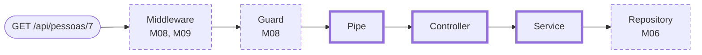

# M03 — NestJS: a primeira API

> **Pré-requisitos:** M01, M02 · **Duração:** média · **Semana:** 4
> **Ementa:** *Mapeamento de URLs; criação de classes / métodos / funções para processamento de requisições.*
> **No projeto:** cria o `backend/` com o primeiro recurso e o `/api/docs` · P2 (critério 4) e P3 (critério 2)

## Por que este módulo existe no projeto

O contrato da equipe (`docs/api.md`) diz **o que** a API oferece. Agora ela precisa existir.
Este módulo cria o esqueleto do backend no repositório de vocês e o primeiro recurso — o do
**cenário principal** —, ainda com dados em memória. O banco entra no M04; a validação no
M07. O que importa hoje é a **estrutura**: cada módulo seguinte preenche um pedaço dela sem
mover nada de lugar.

A organização de código que vocês fixarem aqui é a que quatro pessoas vão seguir até a
semana 18. Por isso a pergunta central do módulo é **"onde fica cada coisa, e por quê"**.

## 🎯 Ao final do módulo

1. O `backend/` do projeto responde JSON em `/api/<recurso-principal>`.
2. A equipe sabe explicar a divisão **module → controller → service** e decidir onde vai cada código.
3. A API não sobe se faltar configuração, e publica a documentação em `/api/docs`.

> **Como fazer em equipe:** uma máquina projetada, **troca de quem digita a cada passo**, os
> outros conferem. No fim, um PR com o `backend/`. É mais lento que cada um no seu canto, e
> é de propósito: todos precisam entender a base.

---

## 📖 Conceitos

### 1. Decorator: uma etiqueta que o framework lê

```ts
@Controller("pessoas")       // "esta classe responde em /pessoas"
export class PessoasController {
  @Get()                     // "este método responde a GET"
  listar() { /* ... */ }
}
```

Um decorator **não executa** o método: só anexa uma informação, como uma etiqueta numa
caixa. Ao subir, o Nest lê as etiquetas e monta a tabela de rotas. O mesmo mecanismo volta
em `@Entity()` (M04) e `@IsString()` (M07).

### 2. As três peças, e a pergunta que decide onde vai o código

Pense num **restaurante**: o garçom (controller) anota o pedido e entrega o prato; a cozinha
(service) sabe fazer o prato.

| Peça | Responsabilidade | Não deve |
| --- | --- | --- |
| **Module** | Agrupar o que pertence a uma área do domínio | Conter lógica |
| **Controller** | Traduzir HTTP ↔ chamada de método: ler rota, corpo, query; devolver dados | Falar com o banco, conter regra |
| **Service** | Regra de negócio e acesso a dados | Saber que HTTP existe |

> **A pergunta:** se este código precisasse rodar a partir de um **comando de terminal**, em
> vez de uma requisição, ele mudaria? **Se não muda, é service. Se muda, é controller.**

| Código | Muda sem HTTP? | Onde |
| --- | --- | --- |
| "Não pode haver dois agendamentos no mesmo horário" | Não — é regra da organização | **Service** |
| Converter o `:id` da URL em número | Sim — sem URL não há `:id` | **Controller** |
| Responder `201` ao criar | Sim — status é HTTP | **Controller** |

**Por que importa no projeto:** a regra no service pode ser testada com uma linha (M10),
reaproveitada por um script (M08) e trocada de fonte de dados sem tocar no controller (M04).
E duas pessoas mexem em arquivos diferentes, sem conflito. A P2 e a P3 conferem isso.

### 3. Injeção de dependência

O controller precisa do service. Em vez de criá-lo com `new`, ele **recebe pronto**, pelo
construtor:

```ts
constructor(private readonly pessoas: PessoasService) {}
```

O Nest lê o tipo do parâmetro, procura quem está declarado em `providers` e entrega a
instância. Como uma geladeira na tomada: ela não constrói a usina. Isso permite trocar o
service por um dublê no teste (M10) e dar a ele a conexão de banco (M04) sem que o
controller saiba.

### 4. Pipe: o porteiro antes do método

```ts
@Get(":id")
buscarUm(@Param("id", ParseIntPipe) id: number) { /* ... */ }
```

O `ParseIntPipe` converte o texto da URL em número **antes** do método. Se não conseguir,
responde `400` sozinho. O `: number` sozinho não converte nada: o TypeScript some quando o
código roda.

### 5. Exceções em linguagem de domínio

```ts
throw new NotFoundException(`Pessoa ${id} não encontrada`);
```

O service diz "não encontrada"; o Nest traduz para `404` com o corpo padrão do contrato
(M02). O service continua sem saber que HTTP existe. Há uma exceção para cada caso comum:
`BadRequestException` (400), `ForbiddenException` (403), `ConflictException` (409).

---

## 🧩 No projeto da equipe

Nos exemplos, o recurso se chama `pessoas`. **Troquem pelo recurso do cenário principal de
vocês** (`agendamentos`, `ferramentas`, `matriculas`...), com os campos que estão no
`docs/api.md`.

### Passo 1 — Conferir e instalar a CLI

```bash
node --version      # v24 ou superior
npm --version       # 11 ou superior
```

> ⚠️ Com npm 10, rode `npm install -g npm@11` antes. O npm 10 falha ao instalar o Nest 12 com
> um erro que não explica nada (`Cannot read properties of null (reading 'edgesOut')`).

```bash
npm install -g @nestjs/cli@12
nest --version      # 12.x
```

A versão é fixada para que **a turma inteira** gere o mesmo projeto.

### Passo 2 — Criar o backend dentro do repositório

Na **raiz** do repositório da equipe, numa branch nova:

```bash
git switch -c feat/backend
nest new backend --skip-git      # escolha npm e tecle Enter
cd backend
npm run start:dev
```

`--skip-git` é obrigatório: sem ele a CLI cria um segundo repositório **dentro** do de
vocês, e o Git da raiz passa a ignorar o `backend/`. **Confira que não existe
`backend/.git`.**

**Deu certo se** <http://localhost:3000> mostra `Hello World!`. Deixe o `start:dev`
rodando: a cada `Ctrl+S` ele recompila sozinho. Abra outro terminal para o resto.

### Passo 3 — Ler os quatro arquivos gerados

| Arquivo | O que faz |
| --- | --- |
| `src/main.ts` | Cria a aplicação a partir de **um** módulo (`AppModule`) e começa a escutar |
| `src/app.module.ts` | Declara o que existe: `imports` (outros módulos), `controllers` (rotas), `providers` (services) |
| `src/app.controller.ts` | `@Get()` na raiz, pede o texto ao service |
| `src/app.service.ts` | Devolve `"Hello World!"` |

> **Por que os imports terminam em `.js` se os arquivos são `.ts`?** O projeto usa módulos
> ESM, e o TypeScript não reescreve caminhos: `src/x.ts` vira `dist/x.js`, e o import precisa
> apontar para o arquivo que vai existir. **Regra:** arquivo seu → com `.js`
> (`"./pessoas.service.js"`); pacote → sem extensão (`"@nestjs/common"`). Se esquecer, o erro
> `TS2835` termina com `Did you mean './x.js'?` — a correção está na mensagem.

### Passo 4 — O módulo do recurso principal

```bash
nest generate module pessoas
nest generate controller pessoas --no-spec
nest generate service pessoas --no-spec
```

A CLI cria os arquivos **e registra** cada um no lugar certo (`imports` do `AppModule`,
`controllers` e `providers` do `PessoasModule`). Esses registros são o que se esquece ao
criar à mão.

Ponha os dados (provisórios) no **service**:

```ts
// src/pessoas/pessoas.service.ts
import { Injectable, NotFoundException } from "@nestjs/common";

export type Pessoa = { id: number; nome: string; telefone: string };

@Injectable()
export class PessoasService {
  // Em memória até o M06, quando o banco assume.
  private pessoas: Pessoa[] = [
    { id: 1, nome: "Ana Souza", telefone: "11 90000-0001" },
    { id: 2, nome: "Bruno Lima", telefone: "11 90000-0002" },
  ];

  listar(): Pessoa[] {
    return this.pessoas;
  }

  buscarUm(id: number): Pessoa {
    const pessoa = this.pessoas.find((p) => p.id === id);
    if (!pessoa) throw new NotFoundException(`Pessoa ${id} não encontrada`);
    return pessoa;
  }
}
```

E o **controller** só traduz HTTP:

```ts
// src/pessoas/pessoas.controller.ts
import { Controller, Get, Param, ParseIntPipe } from "@nestjs/common";
import { PessoasService } from "./pessoas.service.js";

@Controller("pessoas")
export class PessoasController {
  constructor(private readonly pessoas: PessoasService) {}

  @Get()
  listar() {
    return this.pessoas.listar();
  }

  @Get(":id")
  buscarUm(@Param("id", ParseIntPipe) id: number) {
    return this.pessoas.buscarUm(id);
  }
}
```

**Deu certo se:**

```bash
curl -i http://localhost:3000/pessoas        # 200 e a lista   (🪟 curl.exe)
curl -i http://localhost:3000/pessoas/abc    # 400, vindo do pipe
curl -i http://localhost:3000/pessoas/999    # 404, sem vocês terem escrito "404"
```

**Provoque o erro mais comum do módulo:** comente `PessoasService` em `providers` do
`PessoasModule` e salve. O servidor cai com `Nest can't resolve dependencies of the
PessoasController (?)`. A causa quase sempre é uma classe fora de `providers`. Desfaça.

> ⚠️ **Rotas literais antes de rotas com parâmetro.** Um `@Get("resumo")` declarado depois de
> `@Get(":id")` nunca é alcançado: o Nest casa com `:id` e o pipe responde 400.

### Passo 5 — Configuração fora do código, e não subir quebrado

```bash
npm install @nestjs/config zod
```

`backend/.env` (fora do Git) e `backend/.env.example` (no Git, mesmas chaves, sem valores):

```ini
PORT=3000
NOME_ORGANIZACAO=Associação do Bairro
```

`src/config/esquema-env.ts`:

```ts
import { z } from "zod";

export const esquemaEnv = z.object({
  PORT: z.coerce.number().default(3000),
  NOME_ORGANIZACAO: z.string("NOME_ORGANIZACAO é obrigatória").min(1, "NOME_ORGANIZACAO não pode ficar vazia"),
});

export function validarEnv(bruto: Record<string, unknown>) {
  const resultado = esquemaEnv.safeParse(bruto);
  if (!resultado.success) {
    const problemas = resultado.error.issues.map((i) => `  - ${i.message}`);
    throw new Error(`Variáveis de ambiente inválidas:\n${problemas.join("\n")}`);
  }
  return resultado.data;
}
```

No `app.module.ts`, acrescente ao `imports`:

```ts
ConfigModule.forRoot({ isGlobal: true, validate: validarEnv }),
```

**Deu certo se**, comentando `NOME_ORGANIZACAO` no `.env`, a API **não sobe** e diz qual
variável falta. Serviço que não sobe se resolve em dois minutos; serviço que sobe pela metade
falha na frente da organização. Nos próximos módulos, `DATABASE_URL` e `SESSION_SECRET`
entram neste mesmo esquema.

### Passo 6 — Prefixo `/api` e documentação

```bash
npm install @nestjs/swagger
```

`src/swagger.ts`:

```ts
import { INestApplication } from "@nestjs/common";
import { DocumentBuilder, SwaggerModule } from "@nestjs/swagger";

export function montarDocumento(app: INestApplication) {
  const config = new DocumentBuilder()
    .setTitle("<Nome do projeto> API")
    .setDescription("<Uma frase: para quem e para quê>")
    .setVersion("1.0")
    .build();
  return SwaggerModule.createDocument(app, config);
}
```

`src/main.ts`:

```ts
import { NestFactory } from "@nestjs/core";
import { SwaggerModule } from "@nestjs/swagger";
import { AppModule } from "./app.module.js";
import { montarDocumento } from "./swagger.js";

const app = await NestFactory.create(AppModule);
app.setGlobalPrefix("api");
SwaggerModule.setup("api/docs", app, montarDocumento(app));
await app.listen(process.env.PORT ?? 3000);
```

O `/api` custa uma linha hoje; depois do deploy, custaria avisar todo mundo que usa as URLs.

`src/gerar-schema.ts` — grava o contrato num arquivo, sem subir servidor (o CI usa no M11):

```ts
import { writeFileSync } from "node:fs";
import { NestFactory } from "@nestjs/core";
import { AppModule } from "./app.module.js";
import { montarDocumento } from "./swagger.js";

const app = await NestFactory.create(AppModule, { logger: false });
app.setGlobalPrefix("api");
writeFileSync("./openapi.json", JSON.stringify(montarDocumento(app), null, 2));
await app.close();   // sem isto o script não termina
console.log("openapi.json gerado");
```

Em `backend/package.json`, nos `scripts`:

```json
"gerar:schema": "nest build && node dist/gerar-schema.js"
```

**Deu certo se** <http://localhost:3000/api/docs> lista as rotas com *Try it out*
funcionando, e `npm run gerar:schema` cria `backend/openapi.json`. Ninguém escreveu a
documentação: ela saiu dos decorators.

### Passo 7 — Fechar o PR

Atualize o README da raiz ("Como rodar" agora inclui `backend/.env`), confira o `git status`
(nada de `.env` nem `dist/`) e abra o PR `feat/backend`. A revisão é feita por quem **não**
digitou o último passo.

---

## O mapa da requisição

As peças com borda grossa já existem no projeto; as tracejadas chegam nos próximos módulos,
encaixando-se em volta sem mudar o que foi feito:



## ⚠️ Erros comuns

| Sintoma | Diagnóstico |
| --- | --- |
| `nest` não é reconhecido | CLI não instalada, ou terminal aberto antes. Feche e reabra |
| `curl : Não é possível localizar um parâmetro` | No PowerShell, use `curl.exe` |
| `Nest can't resolve dependencies of the XController (?)` | O service não está em `providers` do módulo |
| A rota responde em `/<nome-do-módulo>` | A CLI usou o nome do módulo como rota; ajuste o `@Controller(...)` |
| `/x/1` responde 404 num registro que existe | Faltou o `ParseIntPipe`: `"1" === 1` é `false` |
| `error TS2835 ... Did you mean './x.js'?` | Faltou `.js` num import de arquivo seu |
| Alterou o `.env` e nada mudou | O `.env` só é lido na inicialização: reinicie |
| `npm run gerar:schema` não termina | Faltou `await app.close()` |
| `npm error ERESOLVE` | Um pacote `@nestjs/*` de outra versão principal; alinhe tudo na 12 |

## 🤖 IA no fluxo

Peça "um CRUD em NestJS" e a IA entrega em segundos — quase sempre no formato antigo
(CommonJS, imports sem `.js`, Jest), que domina os exemplos públicos. Use-a para **explicar**
linhas; para escrever, revise pelo critério "a regra está no service?" e pela versão do
projeto.

## ✅ Marco do módulo

- [ ] `backend/` no repositório da equipe, via PR revisado, sem `backend/.git`
- [ ] O recurso do cenário principal responde em `GET /api/<recurso>` e `GET /api/<recurso>/:id`, com 400 e 404 corretos
- [ ] Nenhum dado nem regra no controller
- [ ] A API não sobe sem as variáveis obrigatórias; `.env.example` versionado
- [ ] `/api/docs` abre; `npm run gerar:schema` funciona
- [ ] Cada integrante sabe dizer, para um código qualquer, se ele vai no controller ou no service

## 📚 Para aprofundar

- [NestJS — documentação](https://docs.nestjs.com/) · [Providers e injeção de dependência](https://docs.nestjs.com/providers)
- [NestJS — OpenAPI](https://docs.nestjs.com/openapi/introduction)
- [Slides do M03](../../slides/m03-nestjs.html)
