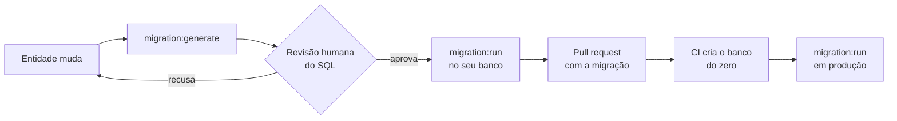
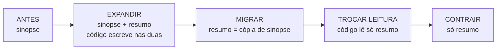

# M05 — Migrações: evoluir o banco com segurança

> **Pré-requisito:** M04 · **Duração:** média

O `synchronize: true` do M04 foi um andaime. Aqui ele cai, e o banco passa a evoluir por
arquivos versionados — como se altera um banco que tem dado dentro.

> A teoria vem quando o código pede: as etapas 1, 6, 9 e 11 são de leitura e raciocínio.

## 🎯 Objetivos

Ao final você será capaz de:

1. Explicar por que `synchronize` não pode ir para produção.
2. Gerar, **revisar**, aplicar e reverter migrações TypeORM.
3. Escrever uma migração de **dados**, não só de esquema, sem perder registros.
4. Planejar uma mudança incompatível pela estratégia expandir → migrar → contrair.
5. Provar que o esquema inteiro nasce do zero a partir das migrações, com um comando.

---

## 🧭 Por que este módulo chega agora

Pense numa **reforma de prédio com os moradores dentro**. A planta nova (a entidade) diz como
o apartamento deve ficar, mas não em que ordem derrubar paredes nem onde guardar os móveis.
Isso é o **cronograma de obra** — escrito antes, revisado, e seguido na mesma ordem em todos
os andares.

No M04 o banco estava vazio e dava para reconstruir à vontade. Agora ele tem dado, e a
migração é o cronograma: cada mudança vira um arquivo que alguém leu antes de rodar.



> **Regra de trabalho.** Migração é código de produção: pequena, nomeada, versionada e
> testada antes. **Nunca apague nem edite uma migração já aplicada** em outro banco além do
> seu — crie outra que corrija o estado.

## 🧭 O que você vai construir

Uma pasta `src/migracoes/`, versionada no Git, com **toda** a história do banco — do
`CREATE TABLE` inicial à última coluna renomeada. Quem clonar o repositório reproduz o banco
com um comando. E, daqui em diante, **nenhuma mudança no banco acontece sem alguém ter lido o
SQL antes**.

## 📋 Como este módulo funciona

Mesmo formato do M03 e do M04 (**Faça → Linha a linha → Rode → Deu certo se**), em treze
etapas curtas.

### As treze etapas

| # | Etapa | Duração | O que entra |
|---|---|---|---|
| 1 | [**Por que trocar o que funciona**](#etapa-1--por-que-trocar-o-que-funciona) | média | **o porquê das migrações** |
| 2 | [Um `DataSource` para a CLI](#etapa-2--um-datasource-para-a-cli) | média | `data-source.ts`, `ts-node` |
| 3 | [Desligar o `synchronize`](#etapa-3--desligar-o-synchronize) | curta | dois lugares, dois programas |
| 4 | [Os atalhos](#etapa-4--os-atalhos) | curta | scripts, e um que não aceita `-d` |
| 5 | [A migração inicial](#etapa-5--a-migração-inicial) | média | `generate` e `run` |
| 6 | [**Ler a migração gerada**](#etapa-6--ler-a-migração-gerada) | média | **anatomia de uma migração** |
| 7 | [Uma coluna nova](#etapa-7--uma-coluna-nova) | média | o ciclo completo |
| 8 | [Reverter](#etapa-8--reverter) | média | `down`, e por que testá-lo |
| 9 | [**A mesma destruição, agora visível**](#etapa-9--a-mesma-destruição-agora-visível) | média | **o argumento do módulo** |
| 10 | [Migração de dados](#etapa-10--migração-de-dados) | média | `create` vs `generate` |
| 11 | [**Expandir e contrair**](#etapa-11--expandir-e-contrair) | média | **deploy sem downtime** |
| 12 | [Expandir e contrair na prática](#etapa-12--expandir-e-contrair-na-prática) | média | quatro migrações |
| 13 | [O banco nasce do zero](#etapa-13--o-banco-nasce-do-zero) | curta | `--check`, README |

---

## Etapa 1 — Por que trocar o que funciona

O banco do M04 nasceu sozinho das classes e funcionava. Por que desmontar? Porque na etapa
16 do M04 o `synchronize` fez coisas muito diferentes com a mesma naturalidade:

| Mudança | O que ele fez | Consequência |
|---|---|---|
| Renomear uma coluna | Deduziu e emitiu `RENAME COLUMN` | Acertou — **naquele caso** |
| `text` → `varchar(10)` com dado dentro | `DROP COLUMN` seguido de `ADD COLUMN` | **Perda total, sem aviso** |
| `nullable` → `NOT NULL` com linhas nulas | Falha na inicialização | A aplicação não sobe |

**O problema não é ele errar** — num caso acertou o mais difícil. **É não saber qual
comportamento você vai receber antes de rodar**, e um deles apaga dados em silêncio.

### Por que não dá para automatizar melhor

Estas perguntas **não têm resposta automática** — e não por limitação de ferramenta:

- Os textos que não cabem em `varchar(10)` devem ser truncados, movidos para outra tabela, ou
  a mudança deve ser recusada?
- A coluna nova `NOT NULL` recebe qual valor nas linhas que já existem?
- Renomear `sinopse` para `resumo` é renomeação mesmo, ou são dois campos diferentes e o
  antigo deve sumir?

Só quem conhece o negócio responde. **A migração registra essa resposta** — escrita antes,
revisada em *pull request*, aplicada na mesma ordem da sua máquina até a produção.

> Em uma frase: você deixa de **descobrir** o que aconteceu com o banco e passa a **decidir**
> o que vai acontecer.

💼 **No mercado:** `synchronize: true` num repositório é achado de auditoria, e explicar por
quê é pergunta corriqueira em entrevista de backend.

---

## Etapa 2 — Um `DataSource` para a CLI

A CLI do TypeORM roda **fora do Nest** — sem `ConfigModule`, sem injeção, sem
`app.module.ts`. Precisa de um arquivo que exporte a configuração sozinho.

**Faça:** crie `backend\src\data-source.ts`:

```ts
import "dotenv/config";
import { dirname } from "node:path";
import { fileURLToPath } from "node:url";
import { DataSource } from "typeorm";

// Este arquivo roda de dois jeitos: como .ts pela CLI (desenvolvimento)
// e como .js já compilado em dist/ (produção). Os caminhos acompanham.
const pasta = dirname(fileURLToPath(import.meta.url));
const ext = import.meta.url.endsWith(".ts") ? "ts" : "js";

export default new DataSource({
  type: "postgres",
  url: process.env.DATABASE_URL,
  entities: [`${pasta}/**/*.entity.${ext}`],
  migrations: [`${pasta}/migracoes/*.${ext}`],
  synchronize: false,
});
```

**Linha a linha:**

| Trecho | O que faz |
|---|---|
| `import "dotenv/config"` | Carrega o `.env` para dentro do `process.env`. Sem o Nest, o `ConfigModule` não está aqui para fazer isso |
| `export default` | A CLI procura a **exportação padrão**. Exportação nomeada não serve, e o erro que isso dá não diz isso |
| `import.meta.url` | O endereço **deste próprio arquivo**, no formato `file:///…/data-source.ts` |
| `pasta` | A pasta onde o arquivo está: `src` quando a CLI roda o fonte, `dist` quando roda o compilado |
| `ext` | `ts` ou `js`, conforme a versão que está rodando. Assim o mesmo arquivo serve agora e em produção (M12) |
| `entities: [...]` | Onde procurar as classes. É delas que a migração é derivada |
| `migrations: [...]` | Onde gravar os arquivos novos e de onde ler os existentes |
| `synchronize: false` | **A linha do módulo.** A partir daqui, o banco só muda por migração |

> **Por que não `"src/**/*.entity.ts"` fixo?** Funcionaria hoje, mas em produção só existe
> `dist/` com `.js` — o erro apareceria no dia do deploy.

**Faça:** instale as duas dependências que faltam:

```powershell
cd backend
```

```powershell
npm install dotenv
```

```powershell
npm install -D ts-node
```

| Pacote | Para quê |
|---|---|
| `dotenv` | Lê o arquivo `.env`. O `ConfigModule` usa isso por baixo, mas aqui não há Nest |
| `ts-node` | Faz a CLI executar os seus `.ts` **direto**, sem compilar. É `-D` porque só o desenvolvimento precisa — a aplicação não usa, e em produção tudo já está compilado (M12) |

**Deu certo se:** o arquivo salva sem erro de tipo. Quem o chama são os atalhos da etapa 4.

---

## Etapa 3 — Desligar o `synchronize`

**Faça:** em `src\app.module.ts`, troque `synchronize: true` por `synchronize: false` e
acrescente a linha das migrações:

```ts
TypeOrmModule.forRoot({
  type: "postgres",
  url: process.env.DATABASE_URL,
  autoLoadEntities: true,
  synchronize: false,                        // ← era true
  migrations: ["dist/migracoes/*.js"],       // ← nova
  logging: true,
}),
```

**São dois lugares porque são dois programas:**

| Programa | Arquivo de configuração | Caminho das migrações |
|---|---|---|
| A **aplicação** (`npm run start:dev`) | `app.module.ts` | `dist/migracoes/*.js` — ela roda **compilada** |
| A **CLI** (`npm run migration:*`) | `data-source.ts` | `src/migracoes/*.ts` — em desenvolvimento, ela roda o **fonte** |

> **Guarde: é o que mais confunde neste módulo.** Se um comando parecer não enxergar suas
> migrações, quase sempre você olhou o caminho do outro programa.

⚠️ **O erro clássico é esquecer o `synchronize: false` do `app.module.ts`.** As migrações
rodam, o banco muda — até a aplicação subir e o `synchronize` "corrigir" o que achar
diferente, desfazendo o trabalho delas.

**Deu certo se:** a aplicação sobe e, no log, **não** há mais nenhum `CREATE TABLE` nem
`ALTER TABLE` na inicialização.

---

## Etapa 4 — Os atalhos

**Faça:** em `backend\package.json`, ao lado dos scripts que já existem:

```json
"typeorm": "typeorm-ts-node-esm -d src/data-source.ts",
"migration:generate": "npm run typeorm migration:generate",
"migration:run": "npm run typeorm migration:run",
"migration:revert": "npm run typeorm migration:revert",
"migration:create": "typeorm-ts-node-esm migration:create"
```

**Linha a linha:**

| Trecho | O que faz |
|---|---|
| `typeorm-ts-node-esm` | Executa a CLI através do `ts-node`, para ela ler os `.ts` direto |
| o sufixo `-esm` | Casa com o projeto ESM que o `nest new` criou (M03). A variante `-commonjs` é para projetos no formato antigo |
| `-d src/data-source.ts` | Diz à CLI onde está a configuração da etapa 2 |
| os três `npm run typeorm …` | Reaproveitam o primeiro, acrescentando o subcomando. Assim o `-d` fica escrito num lugar só |

⚠️ **O `migration:create` não passa o `-d`.** Ele só **escreve um arquivo vazio**, sem
conectar no banco, e por isso **recusa** o parâmetro. Chamado pelo atalho `typeorm`, dá
`Unknown argument: d` — daí o script próprio.

**Deu certo se:**

```powershell
npm run typeorm -- --help
```

lista os subcomandos disponíveis.

---

## Etapa 5 — A migração inicial

O banco atual veio do `synchronize`. Vamos recriá-lo pelo caminho oficial, para existir uma
migração do estado inicial.

**Faça:**

```powershell
docker compose down -v
```

```powershell
docker compose up -d
```

| Trecho | O que faz |
| --- | --- |
| `down` | Para e remove os contêineres |
| `-v` | Remove também o **volume** — ou seja, o banco inteiro |

> Seguro aqui porque não há nada que importe dentro — **pela última vez no curso**.

**Faça:**

```powershell
npm run migration:generate src/migracoes/Inicial
```

| Comando | O que faz |
|---|---|
| `migration:generate <caminho>` | Compara entidades × banco e **escreve** o arquivo. **Não aplica** |
| `migration:run` | Aplica o que ainda não rodou, em ordem de *timestamp* |

**Deu certo se:** aparece `Migration /…/src/migracoes/<números>-Inicial.ts has been generated
successfully.`

> ⚠️ **Gerar não é aplicar.** Entre os dois comandos cabe um passo humano: **revisar**.
> Migração que ninguém leu apaga dados calada, como o `synchronize` no M04.

---

## Etapa 6 — Ler a migração gerada

**Faça:** abra o arquivo. Ele é o M04 inteiro, em SQL.

```ts
import { MigrationInterface, QueryRunner } from "typeorm";

export class Inicial1788295597072 implements MigrationInterface {
  name = 'Inicial1788295597072'

  public async up(queryRunner: QueryRunner): Promise<void> {
    await queryRunner.query(`CREATE TABLE "categoria" (...)`);
    await queryRunner.query(`CREATE TYPE "public"."exemplar_estado_enum" AS ENUM(...)`);
    await queryRunner.query(`CREATE TABLE "exemplar" (...)`);
    // …
    await queryRunner.query(`ALTER TABLE "obra" ADD CONSTRAINT "FK_1fa7f93a…" FOREIGN KEY …`);
  }

  public async down(queryRunner: QueryRunner): Promise<void> {
    await queryRunner.query(`ALTER TABLE "obra" DROP CONSTRAINT "FK_1fa7f93a…"`);
    // …
    await queryRunner.query(`DROP TABLE "categoria"`);
  }
}
```

**Anatomia — o que olhar em qualquer migração:**

| Elemento | Função |
|---|---|
| O número no nome da classe | *Timestamp* de quando foi gerada. Define a **ordem** de aplicação. **Nunca o edite** |
| `up()` | O que a mudança faz |
| `down()` | Como voltar atrás. Repare que ele desfaz **na ordem inversa** — constraint antes de tabela, senão o banco recusa |
| `queryRunner.query` | SQL cru. Migração não usa repositório: a entidade de hoje pode não existir mais quando alguém rodar isto num banco antigo |
| tabela `migrations` | O TypeORM registra ali o que já rodou. É assim que ele sabe o que falta |

**Duas coisas para reparar no arquivo:**

1. **O `CREATE TYPE` vem antes** do `CREATE TABLE "exemplar"` que o usa (M04, etapa 14) —
   agora num arquivo que você controla.
2. **Os nomes das constraints** (`PK_51d3…`, `FK_1fa7…`) são *hashes* feios e
   **propositalmente estáveis**: é assim que o `down()` derruba exatamente o que o `up()` criou.

**Faça:** agora sim, aplique:

```powershell
npm run migration:run
```

**Deu certo se:** o terminal mostra `Migration Inicial<timestamp> has been executed
successfully`, e:

```powershell
docker compose exec db psql -U bibliocom -d bibliocom -c "SELECT * FROM migrations;"
```

devolve uma linha.

> 🤖 **IA no fluxo.** Pedir a uma IA *"explique cada linha desta migração e aponte o que pode
> perder dado"* é um bom segundo par de olhos. Mas *"esse dado pode sumir?"* é pergunta de
> negócio: a IA não sabe quanto valem os textos da `biografia` para a biblioteca.

---

## Etapa 7 — Uma coluna nova

O ciclo completo, agora com uma mudança pequena.

**Faça:** acrescente à entidade `Obra`:

```ts
@Column({ type: "boolean", default: false })
destaque: boolean;
```

**Faça:**

```powershell
npm run migration:generate src/migracoes/AdicionaDestaque
```

**Rode:** confira o arquivo **antes** de aplicar. O `up` deve ter uma linha só:

```ts
await queryRunner.query(`ALTER TABLE "obra" ADD "destaque" boolean NOT NULL DEFAULT false`);
```

Sem o `DEFAULT false`, as linhas existentes ficariam nulas numa coluna `NOT NULL` e a
migração **falharia**. Ele veio do `default: false` da entidade (M04, etapa 8).

**Faça:**

```powershell
npm run migration:run
```

**Deu certo se:** `\d obra` mostra a coluna `destaque`, e a tabela `migrations` agora tem
duas linhas.

---

## Etapa 8 — Reverter

A metade que quase ninguém testa — e a que importa às duas da manhã.

**Faça:**

```powershell
npm run migration:revert
```

**Rode:** o log mostra `ALTER TABLE "obra" DROP COLUMN "destaque"`. Confirme:

```powershell
docker compose exec db psql -U bibliocom -d bibliocom -c "\d obra"
```

**Deu certo se:** a coluna sumiu.

**Faça:** rode `npm run migration:run` de novo. Ela volta.

**Esse par torna o deploy reversível.** Um `down()` nunca executado é **suposição**, não
plano de retorno — e não se descobre isso com o sistema fora do ar.

| Detalhe | Consequência |
|---|---|
| `revert` desfaz **a última aplicada**, sempre | Ele não escolhe e não aceita o nome de uma migração específica |
| Uma por vez | Para voltar três, rode três vezes |
| `down` vazio significa "irreversível" | Declare isso **de propósito**, com um comentário, não por preguiça |

---

## Etapa 9 — A mesma destruição, agora visível

O argumento inteiro do módulo, em poucos minutos.

**Faça:** repita a provocação da etapa 16 do M04 — encurte a `biografia` da `Autor`:

```ts
@Column({ type: "varchar", length: 10, default: "" })
biografia: string;
```

**Faça:**

```powershell
npm run migration:generate src/migracoes/EncurtaBiografia
```

**⚠️ Não rode.** Abra o arquivo:

```ts
await queryRunner.query(`ALTER TABLE "autor" DROP COLUMN "biografia"`);
await queryRunner.query(`ALTER TABLE "autor" ADD "biografia" character varying(10) NOT NULL DEFAULT ''`);
```

**Exatamente** o que o `synchronize` fez no M04: mesmo `DROP`, mesmo `ADD`, mesma perda.

**A diferença: agora você lê isso antes de acontecer** — e pode escolher:

| Opção | Como |
|---|---|
| Aceitar a perda | Rodar a migração como está, sabendo o que ela faz |
| Truncar em vez de apagar | Trocar o SQL à mão por `ALTER COLUMN "biografia" TYPE varchar(10)` |
| Salvar antes | Acrescentar um `UPDATE` que move o texto longo para outro lugar, antes do `ALTER` |
| Recusar a mudança | Concluir que a regra de negócio está errada e o campo deve continuar `text` |

Nenhuma dessas decisões **está na entidade**, então nenhuma ferramenta as toma por você.

**Faça:** apague o arquivo gerado e desfaça a mudança na entidade — era para ler, não aplicar.

> ⚠️ **Aviso para a etapa 12:** o `migration:generate` deduz renomeação como o `synchronize`.
> Renomeie uma propriedade e vem um `RENAME COLUMN` pronto — justamente o que a etapa 12 evita.

---

## Etapa 10 — Migração de dados

Regra nova da coordenação: obras publicadas antes de 1900 entram em destaque. Isso não está
em entidade nenhuma — não há o que o TypeORM comparar.

**Faça:**

```powershell
npm run migration:create src/migracoes/DestacaObrasAntigas
```

| Comando | Quando usar |
|---|---|
| `migration:generate` | A mudança está **nas entidades**. O TypeORM compara e escreve |
| `migration:create` | A mudança está **na sua cabeça**. Ele cria o arquivo vazio e você escreve |

O arquivo nasce com `up` e `down` vazios.

**Faça:** preencha:

```ts
export class DestacaObrasAntigas1738000000001 implements MigrationInterface {
  public async up(queryRunner: QueryRunner): Promise<void> {
    await queryRunner.query(
      `UPDATE "obra" SET "destaque" = true
       WHERE "anoPublicacao" IS NOT NULL AND "anoPublicacao" < 1900`,
    );
  }

  // ⚠️ Este down NÃO restaura o estado anterior: zera tudo, inclusive
  // destaques marcados à mão depois. Ver comentário abaixo.
  public async down(queryRunner: QueryRunner): Promise<void> {
    await queryRunner.query(`UPDATE "obra" SET "destaque" = false`);
  }
}
```

**Linha a linha:**

| Trecho | Por quê |
|---|---|
| `= true` | Booleano do PostgreSQL. Alguns bancos aceitam `1`; este não — e o erro seria de tipo, não de sintaxe |
| `IS NOT NULL AND < 1900` | Obras sem ano ficariam de fora de qualquer jeito, mas escrever a condição deixa a intenção **explícita para quem revisar** |
| `"anoPublicacao"` com aspas | Nome em *camelCase* no PostgreSQL exige aspas. Sem elas, o banco procuraria `anopublicacao` |
| SQL cru, não repositório | A entidade de hoje pode não existir mais quando alguém rodar isto num banco antigo. Migração fala com o banco, não com o código |

**Faça:** ponha dado para a regra morder:

```powershell
docker compose exec db psql -U bibliocom -d bibliocom -c "INSERT INTO autor (nome) VALUES ('Machado de Assis'); INSERT INTO obra (titulo, \"anoPublicacao\", \"autorId\") VALUES ('Dom Casmurro', 1899, 1), ('Grande Sertão', 1956, 1);"
```

**Faça:**

```powershell
npm run migration:run
```

**Rode:**

```powershell
docker compose exec db psql -U bibliocom -d bibliocom -c "SELECT titulo, \"anoPublicacao\", destaque FROM obra;"
```

**Deu certo se:** *Dom Casmurro* está com `destaque = t` e *Grande Sertão* com `f`.

### Olhe o `down` de novo

Ele zera **todos** os destaques, inclusive os marcados à mão depois. Não é reversível de
verdade — seria preciso guardar o estado anterior numa tabela auxiliar.

**Comente a limitação no arquivo**, como no exemplo. Migração de dados raramente é
perfeitamente reversível; melhor **declarar** do que descobrir no pior momento.

---

## Etapa 11 — Expandir e contrair

**A pergunta:** como renomear uma coluna sem derrubar o sistema? O `RENAME COLUMN` preserva
os dados (M04) — por que não usá-lo e pronto?

### Porque o deploy não é instantâneo

Pense na **troca de pista de um aeroporto**: não dá para fechar a velha e abrir a nova no
mesmo segundo, com aviões pousando. Constrói-se a nova ao lado, os voos migram, e só então a
velha fecha.

Em produção, durante alguns minutos de deploy, **as duas versões do código rodam ao mesmo
tempo**: as instâncias antigas atendem enquanto as novas sobem.

```
minuto 0    código v1 rodando           banco com coluna "sinopse"
minuto 1    v1 e v2 rodando juntos      ← e agora?
minuto 2    só v2 rodando               banco com coluna "resumo"
```

Um `RENAME` instantâneo derruba a v1: ela procura `sinopse`, que deixou de existir, e todas
as requisições dela falham.

### A solução: quatro passos, nunca um



| Passo | Migração | Deploy |
|---|---|---|
| 1. Expandir | Cria `resumo`, **mantém** `sinopse` | Código escreve nas duas |
| 2. Migrar | `UPDATE resumo = sinopse` | — |
| 3. Trocar leitura | — | Código lê só `resumo` |
| 4. Contrair | Remove `sinopse` | — |

**Em nenhum momento o código fica incompatível com o banco.** Parece burocracia até você
precisar **reverter** um deploy: com expandir/contrair, o código antigo funciona com o banco
novo; sem, reverter significa restaurar backup.

💼 **No mercado:** *"como você renomearia uma coluna de uma tabela com 10 milhões de linhas,
sem downtime?"* é pergunta clássica de entrevista pleno. A resposta é esta etapa.

---

## Etapa 12 — Expandir e contrair na prática

Agora é com você. Renomeie `Obra.sinopse` para `Obra.resumo` **sem perder dados e sem janela
em que o sistema quebre**.

**Antes de começar:** ponha texto na `sinopse` de alguma obra, para ter o que preservar.

**Uma migração por passo:**

| # | Nome | Conteúdo |
|---|---|---|
| 1 | `ExpandeResumo` | `ADD COLUMN "resumo"` — sem tocar em `sinopse` |
| 2 | `CopiaSinopseParaResumo` | `UPDATE obra SET resumo = sinopse` |
| 3 | *(sem migração)* | Seria o deploy do código que passa a ler `resumo` |
| 4 | `RemoveSinopse` | `DROP COLUMN "sinopse"` |

⚠️ **Use `migration:create` nos três e escreva o SQL você mesmo.** Com `migration:generate`,
o TypeORM deduziria um `RENAME COLUMN` — o que este exercício evita (aviso da etapa 9).

**Ao final:** rode `npm run migration:revert` três vezes e confira que o banco voltou ao
início **com os dados intactos**.

**Responda por escrito:**

1. Depois do passo 1, o código **antigo** ainda funciona com o banco novo? Por quê?
2. E depois do passo 4?
3. Entre quais passos o deploy pode ser revertido com segurança total?
4. Se o passo 3 falhar em produção, qual é o plano?

**Deu certo se:** as três migrações aplicam e revertem sem erro, e o texto que você pôs na
`sinopse` está em `resumo` ao final do passo 2.

---

## Etapa 13 — O banco nasce do zero

Falta provar a promessa do módulo — **qualquer pessoa reproduz o banco com um comando** — e
criar uma rede para o esquecimento mais comum: mudar a entidade sem gerar a migração.

**Faça:** mais um atalho no `package.json`:

```json
"migration:check": "npm run typeorm migration:generate src/migracoes/Pendente -- --check"
```

| Trecho | O que faz |
|---|---|
| `migration:generate … --check` | Compara entidades × banco **sem escrever arquivo nenhum** |
| `--` antes do `--check` | Diz ao `npm` que o `--check` é para o comando de dentro, e não para o próprio `npm` |
| `src/migracoes/Pendente` | Nome que o arquivo *teria*. É obrigatório na sintaxe, mas nada é gravado |

**Rode**, com tudo em dia:

```powershell
npm run migration:check
```

**Deu certo se:** responde `No changes in database schema were found`.

**Agora quebre de propósito:** acrescente um campo qualquer numa entidade, **sem** gerar a
migração, e rode de novo.

**Deu certo se:** o comando mostra `Unexpected changes in database schema were found in check
mode`, imprime o SQL que faltou e **termina com erro**. Desfaça o campo.

> Terminar com erro é o que importa: o CI consegue usar. No M10, o pipeline cria um banco
> vazio, roda `migration:run` e `migration:check` — migração esquecida deixa o *pull request*
> vermelho antes de chegar a qualquer outro banco.

**Faça:** documente no `README.md` do repositório, numa seção **Banco de dados**:

````markdown
## Banco de dados

O esquema é criado **só** por migrações (`synchronize` desligado).

```powershell
docker compose up -d          # PostgreSQL local
cd backend
npm run migration:run         # aplica o que falta
npm run migration:check       # confere se as entidades batem com as migrações
```

Mudou uma entidade? `npm run migration:generate src/migracoes/NomeDaMudanca`, **leia o SQL**
e só então `npm run migration:run`.
````

**Deu certo se:** alguém da sua dupla consegue, só com o README, apagar o banco
(`docker compose down -v`), recriá-lo e chegar ao mesmo esquema que o seu.

---

## ⚠️ Erros comuns

| Sintoma | Diagnóstico |
|---|---|
| `Unknown argument: d` | Você chamou `migration:create` pelo script `typeorm`, que fixa o `-d`. Use o script `migration:create` — etapa 4 |
| `No changes in database schema were found` | As entidades já batem com o banco. Você salvou o arquivo? |
| `Cannot find module 'src/data-source.ts'` | Rode o comando de dentro de `backend/` |
| `DataSource is not set` / a CLI não acha a configuração | Faltou `export default` no `data-source.ts` — etapa 2 |
| A migração roda pela CLI mas não na aplicação | Caminhos diferentes: o fonte na CLI, `dist/**/*.js` na app — etapa 3 |
| `QueryFailedError: relation already exists` | O banco ainda tem as tabelas do `synchronize`. `docker compose down -v` e recrie pelas migrações |
| As tabelas voltaram a mudar sozinhas | Faltou `synchronize: false` no `app.module.ts` — só o `data-source.ts` não basta |
| `migration:revert` desfez a errada | Ele reverte **a última aplicada**, sempre. Não escolhe |
| Conflito de merge em migração | Duas pessoas geraram no mesmo dia. Veja o exercício E05.6 |
| Coluna nova `NOT NULL` falha | Faltou `default` na entidade, e há linhas existentes |
| Gerou `RENAME` quando você queria expandir/contrair | Use `migration:create`, não `generate` — etapa 12 |
| `migration:check` passa local e falha no CI | Seu banco local tem mudança aplicada à mão ou por `synchronize`. Recrie do zero — etapa 13 |

## 💣 Pegadinha de mercado

**Editar uma migração que já rodou em outro banco.** "Só corrigi um nome de coluna" — mas a
tabela `migrations` daquele banco já a registrou como aplicada, e ela **nunca mais roda lá**.
Seu banco fica com um esquema, a produção com outro, até o primeiro erro de coluna
inexistente. Errou? **Crie uma migração nova** que corrige.

## ✅ Checklist de saída

- [ ] `synchronize: false` nos **dois** lugares
- [ ] Migração inicial gerada, **lida** e aplicada; tabela `migrations` com registro
- [ ] Uma migração de esquema aplicada, revertida e reaplicada
- [ ] Uma migração de **dados**, escrita à mão, com `down` honesto e comentado
- [ ] Você gerou a migração destrutiva da etapa 9, **leu e não aplicou**
- [ ] Renomeação feita por expandir/contrair, sem perda de dados
- [ ] `npm run migration:check` passa, e você viu ele falhar de propósito
- [ ] O README documenta como aplicar migrações
- [ ] Migrações versionadas no Git
- [ ] Você sabe explicar por que gerar e aplicar são comandos separados
- [ ] Você sabe explicar por que expandir/contrair existe mesmo com o `RENAME` disponível

## 📦 Entrega do módulo

O histórico de migrações do BiblioCom no repositório, uma explicação curta das decisões
destrutivas ou não reversíveis (etapas 9, 10 e 12) e a evidência de que o esquema nasce do
zero: a saída do `migration:run` num banco recém-criado seguida do `migration:check` limpo.

## 🧩 Desafio de fixação

A coordenação quer que `Obra.isbn` passe a ser **único**. Só que a tabela já tem obras sem
ISBN (texto vazio, o `default` do M04) e duas cadastradas com o mesmo número. Antes de
escrever qualquer código: quantas migrações você faria, em que ordem, e qual delas **não**
pode ser gerada pelo `migration:generate`? Por quê? E o que fazer com as obras sem ISBN,
que também "repetem" o valor vazio?

## 🧪 Exercícios

Ver [`exercicios.md`](exercicios.md).

## 📚 Para aprofundar

- [TypeORM — Migrations](https://typeorm.io/migrations)
- [Expand/Contract pattern (Martin Fowler)](https://martinfowler.com/bliki/ParallelChange.html)
- [PostgreSQL — ALTER TABLE](https://www.postgresql.org/docs/current/sql-altertable.html)
