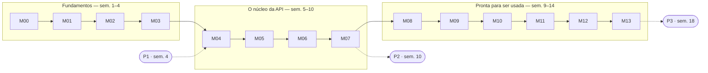

# Módulos de conteúdo

14 módulos, de M00 a M13. Cada módulo ensina uma peça e termina com a equipe aplicando essa
peça no **próprio projeto**.

## Como cada módulo é organizado

| Seção | Para quê |
| --- | --- |
| **Por que este módulo existe no projeto** | O problema concreto do projeto que o módulo resolve |
| 🎯 **Ao final do módulo** | O que a equipe terá e saberá fazer |
| 📖 **Conceitos** | O essencial, com o porquê antes do como e um exemplo curto. Os exemplos usam domínios variados (pessoas, atendimentos, agendamentos) só para ilustrar |
| 🧩 **No projeto da equipe** | Os passos, aplicados ao sistema de vocês, com "Deu certo se" para conferir |
| ⚠️ **Erros comuns** | O que quebra e como diagnosticar |
| ✅ **Marco do módulo** | O que precisa estar no repositório da equipe ao final, e onde é conferido |

Os módulos M04, M06 e M07 têm também um `cheatsheet.md` de referência rápida.

> **Como trabalhar em aula:** a teoria é exposta e discutida em turma; a aplicação acontece
> em laboratório, com a equipe junta. Uma máquina projetada e **troca de quem digita a cada
> passo** funciona melhor que cada um no seu canto: todos precisam entender a base, e a
> arguição da P4 pergunta sobre o que a pessoa **não** escreveu.

## A trilha e o que cada módulo deixa no projeto

| # | Módulo | Semana | Fica no projeto | Conferido em |
| --- | --- | ---: | --- | --- |
| [00](00-ambiente-e-ferramentas/) | Ambiente e ferramentas | 1 | Repositório da equipe, `main` protegida, um PR de cada pessoa | P2 · 4 |
| [01](01-fundamentos-web-http/) | Fundamentos da web e HTTP | 2 | `docs/cenario-http.md`: as requisições do cenário principal | P1 · 5 |
| [02](02-arquitetura-desacoplada/) | Arquitetura desacoplada e contrato | 3 | `docs/api.md`: C4 e contrato inicial | P1 · 5 |
| [03](03-nestjs-primeiros-passos/) | NestJS: a primeira API | 4 | `backend/` com o recurso principal e `/api/docs` | P2 · 4 |
| [04](04-entidades-typeorm/) | Entidades: classes que geram o banco | 5–6 | Entidades do domínio e `docs/modelo-de-dados.md` | P2 · 1 |
| [05](05-migracoes/) | Migrações | 6 | Banco criado só por migrações | P2 · pré-requisito |
| [06](06-orm-consultas-crud/) | Consultas e CRUD | 6–7 | CRUD no banco, sem N+1, com transação | P2 · 2 e 3 |
| [07](07-api-controllers-dtos/) | Rotas, controllers e DTOs | 8–9 | Entrada validada, saída controlada, `openapi.json` | P2 · 2 e 3 |
| [08](08-autenticacao-usuarios/) | Autenticação e autorização | 9–10 | Login, papéis, matriz de acesso | P3 · 3 |
| [09](09-seguranca/) | Segurança de APIs | 11 | `docs/seguranca.md` e as correções | P3 · 3 |
| [10](10-testes-e-qualidade/) | Testes e qualidade | 12 | Testes e CI obrigatório para merge | P3 · 4 |
| [11](11-tipos-compartilhados/) | Contrato OpenAPI versionado | 13 | Contrato conferido no CI e cliente tipado | P3 · 2 |
| [12](12-deploy/) | Deploy da API | 13–14 | **API no ar** e `docs/deploy.md` | P3 · 5 |
| [13](13-observabilidade-e-manutencao/) | Observabilidade e manutenção | 14 | Logs, monitor, backup testado, `docs/manutencao.md` | P3 · 5 · P4 · 6 |

Carga horária e calendário: [plano de ensino](../docs/plano-de-ensino.md#9-cronograma-semanal).

## Dependências

A **P1** (semana 4) vem antes do M04 porque o modelo de dados é o do domínio da equipe: sem
o problema entendido, não há o que modelar.

**Não pule** M01, M02, M04, M05 e M07: todo o resto depende deles.
