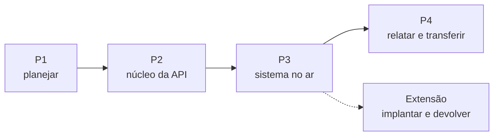

# Projeto Integrador e extensão

Em equipes de **3 a 4 pessoas**, vocês constroem uma **API** que resolve um problema real de
uma **organização parceira** da comunidade. Os módulos existem para viabilizar o projeto; a
parceria é o que o torna extensão.

## As quatro etapas

| Etapa | Entrega | Semana | Peso | Rubrica |
| --- | --- | ---: | ---: | --- |
| [1. Definição e planejamento](etapa-1-definicao-do-tema/) | **P1** — documento do projeto | 10 | 15% | [etapa 1](../avaliacao/rubrica-etapa-1.md) |
| [2. Sistema preliminar](etapa-2-sistema-preliminar/) | **P2** — núcleo da API funcionando | 12 | 10% | [etapa 2](../avaliacao/rubrica-etapa-2.md) |
| [3. Sistema final](etapa-3-desenvolvimento/) | **P3** — API completa, testada e no ar | 18 | 20% | [etapa 3](../avaliacao/rubrica-etapa-3.md) |
| [4. Relatório e encerramento](etapa-4-relatorio-e-encerramento/) | **P4** — relatório, apresentação, transferência | 19–20 | 10% | [etapa 4](../avaliacao/rubrica-etapa-4.md) |
| [Extensão](extensao/) | **X1–X3** — plano, implantação, devolutiva | 15–20 | 10% | [extensão](../avaliacao/rubrica-extensao.md) |

**Eliminatórias:** Etapa 3, Etapa 4 e extensão. Sem elas não há aprovação, qualquer que seja
a média. Composição completa da nota em [`../avaliacao/`](../avaliacao/).

> **Leia a rubrica antes de começar cada etapa.** Cada página de etapa segue a ordem dos
> critérios da rubrica correspondente.

## O que o sistema precisa ter

O mínimo técnico, verificado nas rubricas das Etapas 2 e 3:

| Área | Mínimo |
| --- | --- |
| Dados | 5+ entidades com relações 1-N e N-N, criadas por migrações |
| API | CRUD completo em 2+ recursos, com validação, filtros e paginação |
| Contrato | Swagger em `/api/docs` e `openapi.json` versionado |
| Segurança | Autenticação com 2+ papéis e autorização por dono do recurso |
| Qualidade | 15+ testes automatizados rodando no CI |
| Operação | API pública com HTTPS e `/health` |

**Fora do escopo:** frontend, app mobile, pagamento online, IA/ML.

## Regras

- **Tema:** um por equipe, sem repetição na turma, aprovado na Etapa 1. Não vale clone de
  rede social, "sistema de gestão" sem cliente, nem reimplementar o BiblioCom.
- **Parceria:** organização externa real, com demanda vinda dela e aceite por escrito.
- **Repositório:** um por equipe; `main` protegida (PR com CI verde e 1 aprovação).
- **Todos commitam.** O histórico por autor entra no fator individual.
- **Papéis rotativos:** *Product Owner*, *Tech Lead*, *Scribe*, *Ops*.

**Nota individual** (Etapas 2, 3 e 4) = nota da equipe × fator de 0,7 a 1,1, definido por
commits, avaliação por pares, arguição individual e observação do docente.

## Entregas no calendário

| Semana | Entrega |
| ---: | --- |
| 10 | **P1** — definição e planejamento |
| 12 | **P2** — sistema preliminar |
| 15 | **X1** — plano de ação extensionista |
| 18 | **P3** — sistema final |
| 19 | **X2** — implantação e capacitação |
| 19–20 | **P4** — relatório, apresentação e transferência |
| 20 | **X3** — devolutiva e relato |

Datas exatas no [plano de ensino](../docs/plano-de-ensino.md#9-cronograma-semanal).

## Modelos de documentos

Todos em [`modelos-de-documentos/`](modelos-de-documentos/).

| Etapa | Documentos |
| --- | --- |
| 1 | [canvas](modelos-de-documentos/canvas-do-projeto.md) · [carta de anuência](modelos-de-documentos/carta-de-anuencia.md) · [contrato de equipe](modelos-de-documentos/contrato-de-equipe.md) · [backlog](modelos-de-documentos/backlog-e-historias.md) · [riscos](modelos-de-documentos/matriz-de-riscos.md) · [ADR](modelos-de-documentos/adr.md) |
| 3 | [plano de teste](modelos-de-documentos/plano-de-teste.md) · [ADR](modelos-de-documentos/adr.md) |
| 4 | [relatório técnico](modelos-de-documentos/relatorio-tecnico.md) · [termo de transferência](modelos-de-documentos/termo-de-transferencia.md) · [avaliação por pares](modelos-de-documentos/avaliacao-por-pares.md) |
| Extensão | [relato de experiência](modelos-de-documentos/relato-de-experiencia.md) |
| Todas | [ata de reunião](modelos-de-documentos/ata-de-reuniao.md) |
