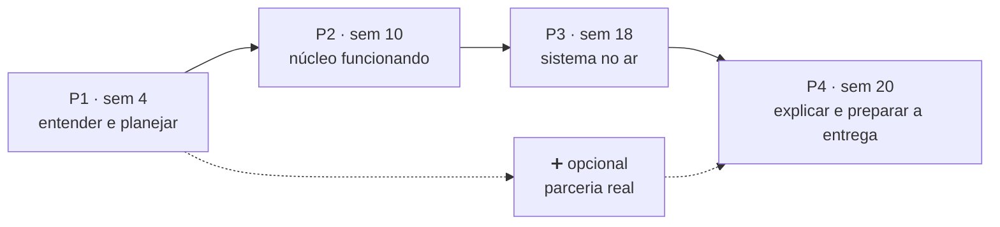

# Projeto integrador

O projeto **é** a disciplina. Em equipes de **3 a 4 pessoas**, vocês constroem uma **API**
que resolve um problema de uma **comunidade** — um setor do próprio campus, uma associação
de moradores, uma cooperativa de agricultura familiar da Mata Sul, uma escola pública, um
cursinho popular. Desde a semana 1, o código que vocês escrevem é o do projeto.

> **Pensado para a comunidade, sem depender dela.** O problema precisa ser plausível e
> fundamentado (pesquisa, relatos, experiência da equipe), mas **não é obrigatório ter uma
> organização real**. Levar o sistema a uma organização de verdade é uma
> [trilha opcional](extensao/) que vale bônus.

> **Como os módulos se ligam ao projeto:** cada módulo ensina uma peça e termina com a seção
> **🧩 No projeto da equipe**, que diz exatamente o que fazer no sistema de vocês. As
> entregas P2 e P3 conferem essas peças. Ver o [mapa completo](#o-que-cada-módulo-deixa-no-projeto).

## O percurso

## As entregas: por que cada uma existe

| Entrega | Semana | Peso | Por que existe | O que precisa provar |
| --- | ---: | ---: | --- | --- |
| [**P1** — Definição e planejamento](etapa-1-definicao-do-tema/) | 4 | 15% | Programar antes de entender o problema é o erro mais caro de um projeto. P1 vem antes do primeiro código de banco (M04) porque o modelo de dados nasce daqui. | Que existe um problema plausível, de pessoas plausíveis, e um plano que cabe no semestre |
| [**P2** — Sistema preliminar](etapa-2-sistema-preliminar/) | 10 | 25% | No meio do semestre ainda dá tempo de corrigir o rumo. Na semana 18, não. | Que o banco e o CRUD do cenário principal funcionam de verdade |
| [**P3** — Sistema final](etapa-3-desenvolvimento/) | 18 | 40% | É o produto. Por isso é a entrega mais pesada e é eliminatória. | Que a API está completa, segura, testada e no ar |
| [**P4** — Relatório e encerramento](etapa-4-relatorio-e-encerramento/) | 19–20 | 20% | Um sistema que só os autores entendem morre quando eles saem. | Que a equipe sabe justificar o que fez, mediu o resultado e deixou tudo pronto para entregar |
| ➕ [**Parceria com a comunidade**](extensao/) | 2–20 | bônus até +1,0 | Para quem quer ver o sistema usado de verdade. Opcional. | Que o sistema foi levado a uma organização real, usado e devolvido |

**Eliminatórias:** P3 e P4. Composição da nota e fator de participação em
[`../avaliacao/`](../avaliacao/).

> **Leia a rubrica antes de começar cada etapa.** Cada página de etapa segue a ordem dos
> critérios da rubrica correspondente.

## O que o sistema precisa ter

O mínimo técnico, conferido na P2 e na P3:

| Área | Mínimo | Por quê |
| --- | --- | --- |
| Dados | 5+ entidades com relações 1-N e N-N, criadas por migrações | Menos que isso raramente sustenta um processo real |
| API | CRUD completo em 2+ recursos, com validação, filtros e paginação | É o que quem usa faz no dia a dia |
| Contrato | Swagger em `/api/docs` e `openapi.json` versionado | Quem consumir a API depois não pode depender de vocês |
| Segurança | Login com 2+ papéis e autorização por dono do recurso | O sistema guarda dados de pessoas |
| Qualidade | 15+ testes automatizados rodando no CI | Para mudar o sistema sem medo de quebrar |
| Operação | API pública com HTTPS, `/health` e backup | Para que alguém possa de fato depender dela |

**Fora do escopo:** frontend, app mobile, pagamento online, IA/ML. A API é usada pelo
`/api/docs` ou por um cliente simples (ver [ADR-02](../docs/decisoes-tecnicas.md#adr-02--o-item-templates-da-ementa)).

## O que cada módulo deixa no projeto

| Módulo | Semana | O que a equipe acrescenta ao sistema | Conferido em |
| --- | ---: | --- | --- |
| [M00](../modulos/00-ambiente-e-ferramentas/) Ambiente | 1 | Repositório da equipe, `main` protegida, fluxo de PR | P2 · critério 4 |
| [M01](../modulos/01-fundamentos-web-http/) HTTP | 2 | As requisições do cenário principal | P1 · critério 5 |
| [M02](../modulos/02-arquitetura-desacoplada/) Contrato | 3 | Rascunho do contrato da API (`docs/api.md`) | P1 · critério 5 |
| [M03](../modulos/03-nestjs-primeiros-passos/) NestJS | 4 | `backend/` respondendo, com o primeiro recurso e `/api/docs` | P2 · critério 4 |
| [M04](../modulos/04-entidades-typeorm/) Entidades | 5–6 | As entidades do domínio e suas relações | P2 · critério 1 |
| [M05](../modulos/05-migracoes/) Migrações | 6 | O banco criado só por migrações versionadas | P2 · pré-requisito |
| [M06](../modulos/06-orm-consultas-crud/) Consultas | 6–7 | Consultas do cenário principal, paginadas e sem N+1 | P2 · critérios 2 e 3 |
| [M07](../modulos/07-api-controllers-dtos/) API e DTOs | 8–9 | CRUD validado, com DTOs e status corretos | P2 · critérios 2 e 3 |
| [M08](../modulos/08-autenticacao-usuarios/) Autenticação | 9–10 | Login, papéis e rotas protegidas | P3 · critério 3 |
| [M09](../modulos/09-seguranca/) Segurança | 11 | Autorização por dono e as correções de segurança | P3 · critério 3 |
| [M10](../modulos/10-testes-e-qualidade/) Testes | 12 | Testes das regras e da matriz de acesso, no CI | P3 · critério 4 |
| [M11](../modulos/11-tipos-compartilhados/) Contrato OpenAPI | 13 | `openapi.json` versionado e conferido no CI | P3 · critério 2 |
| [M12](../modulos/12-deploy/) Deploy | 13–14 | A API no ar, com HTTPS e banco gerenciado | P3 · critério 5 |
| [M13](../modulos/13-observabilidade-e-manutencao/) Operação | 14 | Logs, backup testado e plano de manutenção | P3 · 5 · P4 · 6 |

## Regras

- **Tema:** um por equipe, sem repetição na turma, aprovado na P1. Precisa ser voltado a um
  tipo de organização ou grupo da comunidade. Não vale clone de rede social nem "sistema de
  gestão" genérico.
- **Repositório:** um por equipe, criado no M00; `main` protegida (PR com CI verde e 1
  aprovação).
- **Todos commitam.** O histórico por autor entra no fator de participação.
- **Papéis rotativos** a cada sprint: *Product Owner* (guarda o problema e as personas),
  *Tech Lead* (revisa PRs), *Scribe* (documentação), *Ops* (CI e deploy).

## Ritmo de trabalho

A partir do M03, toda aula termina com a equipe aplicando o módulo no projeto. Fora da aula,
a equipe trabalha em **sprints de 2 semanas**:

| Momento | Duração | Para quê |
| --- | --- | --- |
| Planejamento, no início da sprint | 30 min | Escolher as histórias e dividir o trabalho |
| Acompanhamento, 2×/semana | 10 min | Destravar quem está parado |
| Revisão, no fim | 30 min | Mostrar o que funciona ao docente (e à organização, na trilha opcional) |
| Retrospectiva | 20 min | Ajustar o jeito de trabalhar |

## Modelos de documentos

Todos em [`modelos-de-documentos/`](modelos-de-documentos/), com a indicação de onde cada um
é usado.
